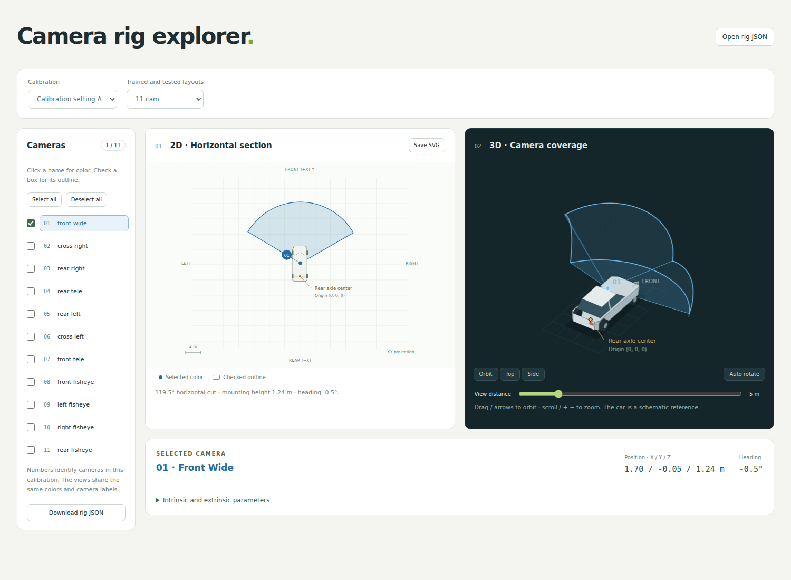

# Camera rig explorer

[Open it locally](index.html) to inspect camera positions, fields of view and
calibration parameters. **Calibration setting A** and **Calibration setting B**
each contain eleven individually selectable cameras.
**Trained and tested layouts** provides 22 camera subsets, named by camera count
and a variant letter when more than one layout has that count.



## Open locally

Open `index.html` in a modern browser. Keep these files together:

- `index.html`
- `styles.css`
- `geometry.js`
- `example-rigs.js`
- `layouts.js`
- `app.js`
- `guide.md`
- `preview.png`

Everything runs locally, including JSON imports, with no CDN, service, build
step or network request. To serve the folder over HTTP instead, run this command
from the folder containing `index.html`:

```bash
python -m http.server 8765 --bind 127.0.0.1
```

Then open `http://127.0.0.1:8765/`. A static website can publish the same eight
files. The usage guide is `guide.md`; MkDocs gives it a distinct `guide/` route,
leaving the application at `index.html`.

## Use the views

1. Choose **Calibration setting A** or **Calibration setting B**, then a
   **Trained and tested layout**: 1, 2, 4, 5, 6, 7, 8, 10 or 11 cameras.
   Letters distinguish different subsets with the same camera count. The default
   is **11 cam**; the page initially selects and checks only its first camera.
   Changing the calibration keeps the chosen layout. Across calibration and
   layout changes, all checked stays all checked, none checked stays none checked,
   and a partial selection keeps only cameras present in both layouts. The
   highlighted camera is retained when available; otherwise the first camera is
   highlighted without changing the checkboxes.
2. Click a camera name to color its coverage. Check a box to draw its outline.
   These controls are independent. **Select all** and **Deselect all** change
   only the outlines; the inspector follows the selected camera.
3. Expand **Intrinsic and extrinsic parameters** to inspect the selected
   camera's image size, principal point, projection coefficients and pose.
   Select another camera or calibration setting to inspect its parameters.
4. Drag the 3D view, use arrow keys, or choose Orbit/Top/Side. Scroll or use `+`/`-`
   to zoom. **Auto rotate** starts or stops continuous orbiting. It pauses while
   dragging and while the page is hidden. The vehicle and front arrow provide
   orientation; the vehicle is a schematic reference.
5. Save a standalone 2D SVG, or export the chosen layout's cameras as JSON for
   reopening with **Open rig JSON**. Outline selection changes the display, not
   the exported layout. Imported files use their own camera list; the built-in
   layout selector is disabled until a built-in calibration is selected again.
   JSON preserves full numerical precision; the
   inspector rounds numbers for readability.

Numbers identify cameras within the selected calibration. Camera names describe
position or lens type; use their calibrated parameters when matching a setup.
The examples represent two individual calibrations, not universal vehicle models.

## Calibration conventions

- Rig coordinates are **+X forward, +Y left, +Z up**, in meters. The 2D view maps
  forward upward and left leftward. For **Calibration setting A** and
  **Calibration setting B**, the rig origin **(0, 0, 0) is at the center of the
  rear axle**. Camera positions and extrinsic translations are measured from
  that origin. Both views label this point **Rear axle center · Origin (0, 0, 0)**,
  and the schematic vehicle's rear axle is aligned with it. Imported files retain
  their supplied coordinate origin, labeled **Rig origin** in the views.
- Camera coordinates are **+X right, +Y down, +Z forward**. The extrinsics map
  points as `p_rig = camera_to_rig × p_camera + origin`. The rotation's third
  column is the camera's optical axis.
- The examples use a radial polynomial projection. With pixel position `p`,
  principal point `c` and affine matrix `A`, compute `q = inverse(A) × (p − c)`
  and `r = norm(q)`. The polynomial maps radius `r` in pixels to off-axis angle
  `θ` in radians, or the reverse, as specified by `polynomial_type`.
  Coefficients are ordered from the constant term upward. These coefficients
  are not a pinhole focal-length matrix or a different distortion model's
  coefficients.
- Heading is the optical axis's azimuth: front 0°, left +90°, rear ±180° and
  right −90°. A vertical optical axis has no horizontal heading.
- 2D fans are supplied horizontal sections through each camera's optical
  center, flattened into XY. The examples use an **8 m** radius.
- 3D outlines follow calibrated image-border unit rays already expressed in
  rig coordinates. Fisheye support remains curved. View distance affects only
  the 3D drawing; it does not change the 2D fans or the calibration.

Occlusion and scene depth are not modeled. Missing geometry or intrinsic
parameters are marked unavailable rather than estimated from camera names.

Dense imports retain their exact 2D polygons and reuse the same SVG paths during
selection changes. The 3D display samples at most 256 boundary rays per camera
and 8,192 in total, preserving ordered extrema. This changes only the display;
exported JSON retains every original ray. Rotation reuses the Canvas backing
store and stops recurring redraws during a held drag.

## Import another calibration

Import an exported JSON file or a file matching this geometry contract. Files
are limited to 4 MiB and 64 cameras. Invalid imports leave the current rig intact.
The viewer consumes calibrated rays and sections; it does not derive them from
a raw sensor calibration file.

| Field                            | Contract                                                                                                                                                        |
| -------------------------------- | --------------------------------------------------------------------------------------------------------------------------------------------------------------- |
| `layout`                         | A display label                                                                                                                                                 |
| `camera_keys`                    | Unique camera names aligned with `geometry`                                                                                                                     |
| `geometry[i]`                    | `status`; qualified entries contain finite `origin` [3], a proper `camera_to_rig` rotation [3,3], and unit `outline_rays` [N,3]                                 |
| `geometry[i].horizontal_section` | `status`; qualified sections contain `polygons_xy` [polygons,vertices,2], positive `radius_m`, `height_m`, and `total_angle_degrees`                            |
| `geometry[i].intrinsics`         | Optional radial polynomial parameters: positive integer `width`/`height`, `center` [2], invertible `affine` [2,2], `polynomial_type`, and finite `coefficients` |

`polynomial_type` is `pixeldistance-to-angle` or `angle-to-pixeldistance`.
`outline_rays` have already been rotated to rig coordinates and must not be
rotated a second time. Intrinsics are displayed as supplied; they do not replace
or regenerate the imported rays and polygons. Validation checks shapes and
numerical validity, not consistency between independently supplied calibration
fields. Additional metadata in a user-imported file is retained on JSON export.

## Verification

The script and stylesheet URLs in `index.html` include the first twelve characters
of each file's SHA-256 digest. Update these versions when editing the assets so
HTTP caches do not reuse older files. The browser check verifies both the versions
and the actual loaded bytes, as well as offline opening.

From this folder, run the dependency-free geometry checks:

```bash
node --test tests/geometry.test.cjs
```

Browser verification requires Python, Playwright and Chromium. Run these commands
in an environment suitable for browser automation, following your workspace's
execution policy:

```bash
python tests/browser_smoke.py --output /path/to/browser-evidence
python tests/docs_smoke.py --output /path/to/docs-evidence
```

The browser check covers every layout in both settings, all camera controls and parameter
inspection, JSON/SVG exports, valid and invalid imports, dense geometry,
automatic rotation, high-DPI resizing, mobile touch and offline use. The second
command additionally requires MkDocs and verifies separate application and guide
routes. Screenshots and machine-readable verification records are saved in the
specified output directories.
