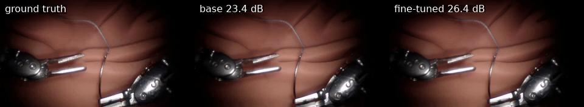
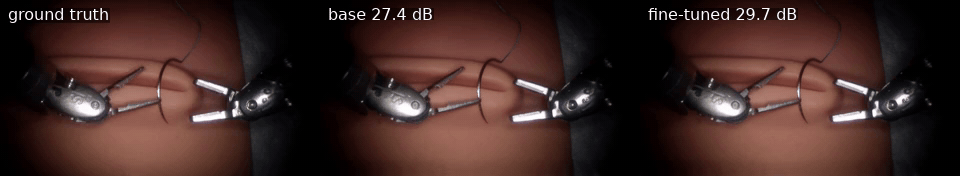
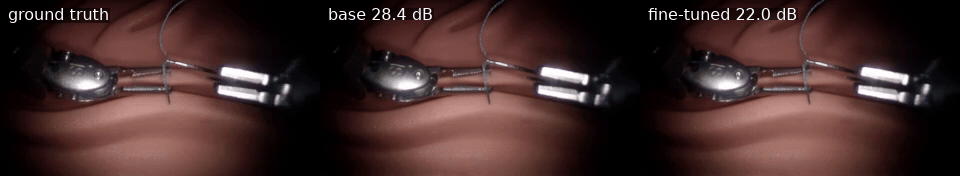

<!-- SPDX-FileCopyrightText: Copyright (c) 2026 NVIDIA CORPORATION & AFFILIATES. All rights reserved. -->
<!-- SPDX-License-Identifier: OpenMDW-1.1 -->

# Forward-dynamics post-training of Cosmos3-H-Embodied-Nano on SutureBot

> **Authors:** [Lukas Zbinden](https://github.com/lukaszbinden) · [Nigel Nelson](https://github.com/NigelNelson) · [Maximilian Ofir](https://github.com/maximilianofir)
> **Organizations:** NVIDIA

A surgical robot policy is expensive to evaluate on hardware: every trial needs a robot, a phantom and
an operator. An action-conditioned world model replaces part of that loop. Given the current endoscope
frame and the robot's next commands, it predicts the video that the robot would see, so a policy can
be rolled out, compared and debugged in simulation. This recipe adapts such a world model to a new
dataset: it post-trains the **forward-dynamics** mode of Cosmos3-H-Embodied-Nano on
[SutureBot](https://huggingface.co/datasets/jchen396/SutureBot), autonomous suturing demonstrations
recorded on a da Vinci Research Kit (dVRK).

Cosmos3-H-Embodied-Nano is Cosmos3-Nano post-trained on the Open-H surgical robotics mixture with a
16-step action history. One model does forward dynamics (first frame + actions → video), inverse
dynamics (video → actions) and policy (frame + instruction → actions and video). This recipe trains
forward dynamics only. SutureBot is downloaded by the user from its publisher as raw JPEG frames and
CSV kinematics, converted to LeRobot v3.0 with a script in this folder, and split by tissue phantom.
The recipe produces a fine-tuned DCP checkpoint and per-sample predicted videos for held-out episodes.

The measured result is video PSNR between predicted and recorded 2.4 s clips (25 frames at 10 Hz,
256-pixel tier), paired clip by clip against the released checkpoint (the control). After 3,000
iterations, PSNR on held-out episodes of the training phantoms rises by +0.79 ± 0.13 dB (mean ± SEM
over 128 clips), with a gain in each of the three tasks. On the held-out phantom (tissue 3), the change
is −0.04 ± 0.14 dB: the fine-tuned model specializes to the phantoms it was trained on and does not
regress on an unseen one, but it does not improve on it either. Two uses remain outside the measured
scope: closed-loop policy evaluation (rolling out a policy inside the model) and the policy mode of the
model.

| Model                                                                                                                                            | Workload                                                                                | Inputs                                                                                                     | Output                                    |
| ------------------------------------------------------------------------------------------------------------------------------------------------ | --------------------------------------------------------------------------------------- | ---------------------------------------------------------------------------------------------------------- | ----------------------------------------- |
| [`nvidia/Cosmos3-H-Embodied-Nano`](https://huggingface.co/nvidia/Cosmos3-H-Embodied-Nano) at revision `710459f061e0ddc0f4cbd8a581e686efb013839b` | Full SFT of the generation expert (6.98 B of 15.17 B parameters), forward dynamics only | First endoscope frame, 24 future actions (dual-PSM pose + jaw, 10 Hz), up to 16 past actions, task caption | 25-frame endoscope video (2.4 s at 10 Hz) |



**Hero caption.** Test split (tissue 3), sample `1530`, task `needle throw`, fine-tuned checkpoint
`iter_3000`, seed 20260908, 35 sampling steps, guidance 6.0, 320×176, 25 frames at 10 Hz. Left to
right: recorded video, released checkpoint (23.4 dB), fine-tuned checkpoint (26.4 dB); all three start
from the same recorded first frame and receive the same recorded actions. Both models follow the
recorded motion of both needle drivers; the fine-tuned prediction is closer in fine detail (needle
arc, thread). The difference is subtle at this size; this clip has the largest gain on the test split,
not a typical one. [Open the video](assets/hero.mp4).

The hero is a qualitative preview. The measured result belongs in
[Results / expected output](#results--expected-output).

## What you'll build

- A fine-tuned Cosmos3-H-Embodied-Nano DCP checkpoint specialized to SutureBot forward dynamics.
- Predicted and recorded videos for 128 held-out clips per split (`vision.mp4`, `vision_gt.mp4`),
  per-sample `metrics.json` (video PSNR) and a paired comparison in `outputs/metrics.json`, to compare
  with the measured reference in `results/metrics.json`.
- Measured runtime, GPU memory and GPU-hours for conversion, training and evaluation (see the
  [cost card](#cost-card)).
- Control: the released checkpoint evaluated on the same clips with the same seed, sampler and
  inputs. The checkpoint is the only variable.
- Scope: dVRK (da Vinci Research Kit) dual-PSM robots with a single endoscope view, Cartesian
  pose + jaw kinematics, 10 Hz action chunks of 24 steps, 256-pixel tier. Policy mode is not covered.

## Pipeline

| Stage | What happens                                                                                    | Expected time and hardware                                                                                                                                                                                                                                                                                               |
| ----- | ----------------------------------------------------------------------------------------------- | ------------------------------------------------------------------------------------------------------------------------------------------------------------------------------------------------------------------------------------------------------------------------------------------------------------------------ |
| 1     | Download SutureBot at the pinned revision (10 tissue zips, 221 GB) and the released checkpoint. | Network- and disk-bound. Measured on a network file system, one job per tissue in parallel: download plus unzip took 2–50 min per tissue in one run and 2–109 min in another (the Hub download itself takes minutes); the script processes tissues one after another (about 4.4–10 h for all ten, estimated as the sum). |
| 2     | Convert SutureBot to LeRobot v3.0 (one root per tissue) and the checkpoint to DCP.              | Data: 63 min for all 662,298 frames with `--workers 10` on a 96-core CPU node, measured (12 CPU-hours of process time). Checkpoint: 88 s on CPU, measured.                                                                                                                                                               |
| 3     | Smoke test: the real launcher and config with a 2-layer model.                                  | About 4 min on one A100 80 GB, measured (about 1 min on an RTX A6000).                                                                                                                                                                                                                                                   |
| 4     | Post-train forward dynamics, 3,000 iterations.                                                  | 3 h 24 min on 8× A100 80 GB (27 GPU-hours), measured over two jobs with one restart.                                                                                                                                                                                                                                     |
| 5     | Pick checkpoints; evaluation loads the training DCP directly (no export step).                  | —                                                                                                                                                                                                                                                                                                                        |
| 6     | Evaluate the released and fine-tuned checkpoints on the val and test splits.                    | 22–26 min per checkpoint (2 × 128 clips: about 4–5 min of model load per split plus about 4 s per clip) on one A100 80 GB, measured.                                                                                                                                                                                     |
| 7     | Compare with the control and write `outputs/metrics.json`.                                      | Seconds, CPU.                                                                                                                                                                                                                                                                                                            |

## Prerequisites

The commands below use three directories side by side: cosmos-framework on `main`, which holds this
recipe; a worktree of cosmos-framework at the pinned revision, which provides the environment (training
and inference stack; `cosmos3_h_embodied` is validated against it and this recipe was measured with it);
and [NVIDIA-Medtech/Cosmos3-H-Embodied-Nano](https://github.com/NVIDIA-Medtech/Cosmos3-H-Embodied-Nano),
which ships the `cosmos3_h_embodied` package (the model's data loaders, history mechanism and
evaluation). This folder, `.agents/skills/cosmos-h-surgical-robotics/` of the `main` checkout, is the
recipe directory; its path is `$RECIPE_DIR`. The pinned revision predates this recipe, so do not check
it out in the `main` checkout.

```bash
git clone https://github.com/NVIDIA/cosmos-framework.git          # main: holds this recipe
git -C cosmos-framework worktree add ../cosmos-framework-7cfaf78 7cfaf7854b2114eda5deb36250a7e8f00c64d69e
cd cosmos-framework-7cfaf78                                       # the environment is built at the pinned revision
uv sync --all-extras --group=cu130-train          # or cu128-train on older drivers (the measured runs used cu128-train)
source .venv/bin/activate && export LD_LIBRARY_PATH=
cd ..

git clone https://github.com/NVIDIA-Medtech/Cosmos3-H-Embodied-Nano.git
git -C Cosmos3-H-Embodied-Nano checkout 14d1626700b532e1dad27c0f99f0d46389b5234b   # revision that ships cosmos3_h_embodied
uv pip install --no-deps -e Cosmos3-H-Embodied-Nano             # into the cosmos-framework environment
cd cosmos-framework/.agents/skills/cosmos-h-surgical-robotics     # the recipe directory ($RECIPE_DIR)
```

**Container.** The measured runs ran on hosts with driver 535, Ubuntu 20.04 (glibc 2.31) and no FFmpeg, so
every step ran in a container: `nvcr.io/nvidia/cuda:12.8.1-cudnn-devel-ubuntu24.04` with `ffmpeg git git-lfs
curl unzip` installed and `uv` 0.11 from the host. A blind reproduction of the setup, smoke test and
control evaluation used `nvcr.io/nvidia/pytorch:25.06-py3` with the same packages. Keep the venv and uv's
Python install directory (`UV_PYTHON_INSTALL_DIR`) on storage that every job mounts. With SLURM and
pyxis, for example (paths are placeholders):

```text
srun --container-image=nvcr.io#nvidia/cuda:12.8.1-cudnn-devel-ubuntu24.04 --container-save=/work/cuda128-ffmpeg.sqsh \
    --container-remap-root bash -c 'apt-get update && apt-get install -y --no-install-recommends ffmpeg git git-lfs curl unzip ca-certificates'
srun --container-image=/work/cuda128-ffmpeg.sqsh --container-mounts=/work:/work,/data:/data bash -c '<commands>'
```

| Requirement                                                                                                                                                                                            | Why                                                                                                                                                                                                                                                                                                               |
| ------------------------------------------------------------------------------------------------------------------------------------------------------------------------------------------------------ | ----------------------------------------------------------------------------------------------------------------------------------------------------------------------------------------------------------------------------------------------------------------------------------------------------------------- |
| Training: 8× NVIDIA A100 80 GB (measured); 4× 80 GB is the minimum that fits (measured in a 25-iteration probe)                                                                                        | Full SFT keeps fp32 master weights for all 15.17 B parameters plus gradients, AdamW state and EMA for the 6.98 B trainable ones, sharded with FSDP. Measured: 2× A100 80 GB run out of memory in the first training step; 2× 48 GB GPUs run out of memory while the model is set up (43–47 GB allocated per GPU). |
| Evaluation: one GPU with ≥ 40 GB                                                                                                                                                                       | Measured peak 31–32 GB on an RTX A6000 (48 GB) and on an A100 80 GB for bf16 inference.                                                                                                                                                                                                                           |
| Driver for CUDA 13.0 (`cu130-train`) or 12.8 (`cu128-train`)                                                                                                                                           | cosmos-framework training extras; see its `docs/setup.md`. The measured runs used `cu128-train` in a CUDA 12.8 container on driver 535 (see Container below).                                                                                                                                                     |
| Model access: [`nvidia/Cosmos3-H-Embodied-Nano`](https://huggingface.co/nvidia/Cosmos3-H-Embodied-Nano), public, no acceptance step                                                                    | Released checkpoint (`c3-h-e-n_model_bf16.safetensors`, 30 GB bf16, NVIDIA Open Model License), converted to a 61 GB DCP directory whose `model/` holds `net` and `net_ema` (the EMA starts as a copy).                                                                                                           |
| Dataset access: [`jchen396/SutureBot`](https://huggingface.co/datasets/jchen396/SutureBot), public, no acceptance step                                                                                 | CC-BY-4.0.                                                                                                                                                                                                                                                                                                        |
| Hugging Face Hub access on the first run                                                                                                                                                               | The first training and evaluation run downloads the Wan2.2 VAE and the Qwen3-VL tokenizer; the loaders switch the Hub to offline mode unless `HF_HUB_OFFLINE` is set, so run the first time with `HF_HUB_OFFLINE=0`.                                                                                              |
| CPU RAM ≥ 160 GB for 8-GPU training                                                                                                                                                                    | Measured peak host memory: 147 GB for 8-GPU training (8 data-loader workers per GPU), 61 GB for 4 GPUs, 29 GB for checkpoint conversion, 6 GB for the smoke test.                                                                                                                                                 |
| Disk: 221 GB raw zips (can be streamed one tissue at a time) + 224 GB unzipped + 11 GB converted + 30 GB + 61 GB checkpoint + 177 GB per training checkpoint (1.06 TB for the six default checkpoints) | Delete the raw data after conversion.                                                                                                                                                                                                                                                                             |
| `ffmpeg` (with its shared libraries)                                                                                                                                                                   | `torchcodec` decodes the training and evaluation videos with the system FFmpeg libraries; `scripts/make_comparison.py` calls `ffmpeg`.                                                                                                                                                                            |

### Hardware

| Configuration                                         | Post-training                                                                                                                                                                                    | Evaluation                                                                                                                 |
| ----------------------------------------------------- | ------------------------------------------------------------------------------------------------------------------------------------------------------------------------------------------------ | -------------------------------------------------------------------------------------------------------------------------- |
| 8× A100 80 GB (measured run)                          | 3,000 iterations in 3 h 24 min (27 GPU-hours, two jobs with one restart), 3.7 s per iteration (median); peak memory per GPU 31 GB allocated, 37 GB reserved by PyTorch, 47–50 GB in `nvidia-smi` | 1 GPU: 32 GB peak; 22–26 min per checkpoint (2 × 128 clips: about 4–5 min of model load per split plus about 4 s per clip) |
| 4× A100 80 GB                                         | Fits (25-iteration probe): 73 GB per GPU in `nvidia-smi`, 4.0 s per iteration; half the clips per step of the 8-GPU run                                                                          | —                                                                                                                          |
| 2× A100 80 GB                                         | Does not fit (measured: OOM in the first training step)                                                                                                                                          | —                                                                                                                          |
| 1× RTX A6000 48 GB                                    | Does not fit (measured: OOM at model setup, also with 2 GPUs)                                                                                                                                    | 31 GB peak; about 7 s per clip at 35 steps, measured                                                                       |
| 1× A100 80 GB or RTX A6000 48 GB, 2-layer smoke model | 2 iterations + checkpoint write: 4–7 min on the A100 (first run; longer with the environment on a network file system), about 1 min on the A6000, measured; 31 GB peak on the A100               | Not applicable (inference always builds the full model)                                                                    |

### GPU you need

| Step                  | Minimum that fits                                                          | Measured configuration                                   | Time                                                      |
| --------------------- | -------------------------------------------------------------------------- | -------------------------------------------------------- | --------------------------------------------------------- |
| Data conversion       | CPU only                                                                   | 96-core CPU node, `--workers 10` (one tissue per worker) | 63 min for all ten tissues (12 CPU-hours of process time) |
| Checkpoint conversion | CPU only (29 GB peak RAM, measured)                                        | CPU node                                                 | 88 s                                                      |
| Smoke test            | 1 GPU                                                                      | 1× A100 80 GB; 1× RTX A6000 48 GB                        | 4–7 min; about 1 min                                      |
| Full post-training    | 4× 80 GB GPUs (measured to fit; 2× 80 GB and 2× 48 GB measured not to fit) | 8× A100 80 GB                                            | 3 h 24 min (3,000 iterations)                             |
| Evaluation            | 1 GPU with ≥ 40 GB                                                         | 1× A100 80 GB                                            | 22–26 min per checkpoint                                  |

## Dataset

| Name                       | Source                                                                                                                            | Licence   | Size                                                                       |
| -------------------------- | --------------------------------------------------------------------------------------------------------------------------------- | --------- | -------------------------------------------------------------------------- |
| SutureBot, all ten tissues | [`jchen396/SutureBot`](https://huggingface.co/datasets/jchen396/SutureBot) at revision `59fd8016649d605a041f2b0e4047702d2ea45ac1` | CC-BY-4.0 | 221 GB of zips; 1,891 episodes, 662,298 frames per camera (6.1 h at 30 Hz) |

Each user is responsible for checking the content of datasets and the applicable licenses and determining if suitable for the intended use.

SutureBot ([project page](https://suturebot.github.io/)) records a dVRK performing three suturing
subtasks on tissue phantoms: needle pickup, needle throw and knot tying, each with normal and
recovery demonstrations. Each episode folder has stereo endoscope frames and two wrist-camera frames
(JPEG, 30 Hz) and an `ee_csv.csv` with the kinematics. Download it from the publisher with
`scripts/download_suturebot.sh`; this recipe does not bundle or rehost any of it.

The converter (`scripts/convert_suturebot_to_lerobot.py`) writes one LeRobot v3.0 root per tissue,
`$OPENH_DATA_ROOT/suturebot/tissue_<N>/` (the data layout of `cosmos3_h_embodied`), with:

| Field                               | Content                                                                                                                    |
| ----------------------------------- | -------------------------------------------------------------------------------------------------------------------------- |
| `observation.images.endoscope.left` | Left endoscope, 960×540, H.264 (CRF 20), 30 fps. `--all-views` adds the right endoscope and the wrist cameras.             |
| `observation.state` (16-D)          | Per PSM (patient-side manipulator, the robot arms): measured tool pose `xyz` + quaternion `xyzw`, measured jaw angle       |
| `action` (16-D)                     | Per PSM: pose setpoint `xyz` + quaternion `xyzw`, jaw setpoint                                                             |
| task                                | `needle pickup`, `needle throw` or `knot tying`, from the subtask folder (recovery folders keep the task of their subtask) |
| `meta/modality.json`                | Column layout for the `cosmos3_h_embodied` loaders                                                                         |
| `meta/suturebot_episodes.json`      | Source folder, task, recovery flag and length of every episode, plus any skipped episode                                   |

The loader turns each 2.4 s window into the model's 20-D relative action: per PSM, translation since
the window's first frame (world frame), rotation since the first frame (6-D), and jaw angle. It
normalizes the actions with the SutureBot statistics the released checkpoint was trained with.

| Tissue | Episodes |  Frames | Recovery episodes | Use         |
| -----: | -------: | ------: | ----------------: | ----------- |
|      1 |      211 |  64,643 |                30 | train / val |
|      2 |      381 | 126,348 |                78 | train / val |
|      3 |      130 |  44,245 |                34 | **test**    |
|      4 |      162 |  55,508 |                 3 | train / val |
|      5 |      312 | 104,343 |                 2 | train / val |
|      6 |      197 |  67,984 |               112 | train / val |
|      7 |      303 | 121,204 |                 8 | train / val |
|      8 |       70 |  29,342 |                69 | train / val |
|      9 |      113 |  43,988 |               112 | train / val |
|     10 |       12 |   4,693 |                 6 | train / val |

Counts come from the zip listings at the pinned revision (episodes = `ee_csv.csv` files, frames =
left endoscope images).

## Splits

| Split      | Content                                                                                                                                                                                            |
| ---------- | -------------------------------------------------------------------------------------------------------------------------------------------------------------------------------------------------- |
| Train      | Tissues 1, 2, 4–10 without their val episodes: 1,671 episodes, 59,119 training windows of 2.4 s (measured from the loader's `kept` log lines).                                                     |
| Validation | 90 episodes (3,190 windows): 5% of each training tissue, drawn per tissue with seed 42 (`split_val_ratio=0.05`, `split_seed=42`). Not used during training; evaluated as an in-distribution check. |
| Test       | Tissue 3, all 130 episodes (4,418 windows; all three tasks, 34 recovery). Never seen by the fine-tuning run.                                                                                       |

Splits are made at the episode level (val) and at the tissue-phantom level (test), so no window of a
val or test episode is trained on, and the test tissue's phantom never appears in fine-tuning. Both
selection rules are deterministic, so every user gets the same episodes.

**Overlap with the base model's training data.** The released checkpoint's training mixture included
SutureBot recordings from the same lab and robot, so some val and test episodes may also have been
seen by the base model. The test split is therefore held out from fine-tuning, not from pretraining,
and the measured gain is the gain of specializing the model to this dataset. It is not a measure of
generalization to an unseen robot.

## Post-training

`suturebot_fd/config.py` follows the "fine-tune on your own data" path of `cosmos3_h_embodied`. It
adds two dataset families to the package's `FAMILIES`: `suturebot` (the training tissues) and
`suturebot_test` (the test tissue), with the `suturebot` embodiment, caption context and shipped
action statistics. It then builds the experiments with `register_experiment`, which makes them like
the released recipe `openh_h16_task_prompt` except for the family, the mode (forward dynamics) and
the run length: `suturebot_fd` (training), `suturebot_fd_smoke` and `suturebot_fd_test`
(evaluation data). In the package itself, the same is a `FAMILIES` entry in
`configs/openh_datasets.py` and `register_experiment` calls in `configs/experiment_h16.py`.
cosmos-framework's `--sft-toml` loader can only load experiments registered inside
cosmos-framework, so this recipe ships a Hydra experiment instead of a TOML. The launcher exports it
to YAML with `cosmos_framework.scripts.export_config` and trains with `cosmos_framework.scripts._train`.

| Setting                            | Value                                                                                                                                                                                                                                                                                                                                                         |
| ---------------------------------- | ------------------------------------------------------------------------------------------------------------------------------------------------------------------------------------------------------------------------------------------------------------------------------------------------------------------------------------------------------------- |
| Framework                          | `7cfaf7854b2114eda5deb36250a7e8f00c64d69e`; `cosmos3_h_embodied` at `14d1626700b532e1dad27c0f99f0d46389b5234b`                                                                                                                                                                                                                                                |
| Base model                         | `nvidia/Cosmos3-H-Embodied-Nano` at `710459f061e0ddc0f4cbd8a581e686efb013839b`                                                                                                                                                                                                                                                                                |
| Dataset                            | `jchen396/SutureBot` at `59fd8016649d605a041f2b0e4047702d2ea45ac1`                                                                                                                                                                                                                                                                                            |
| Method                             | Full SFT of the generation expert and the action/vision projections (`moe_gen`, `time_embedder`, `vae2llm`, `llm2vae`, `action2llm`, `llm2action`, `action_modality_embed`; 6.98 B of 15.17 B parameters). The reasoning (understanding) expert is frozen.                                                                                                    |
| Mode                               | Forward dynamics only: first frame, 24 future actions and up to 16 past actions (clean history) → 24 frames. Video loss only.                                                                                                                                                                                                                                 |
| Training seed                      | 0 (one training seed)                                                                                                                                                                                                                                                                                                                                         |
| Learning rate and schedule         | 1e-5 constant after 100 warm-up steps (base 2e-4 × 0.05); ×5 on the action projections                                                                                                                                                                                                                                                                        |
| Global batch                       | One packed sequence of up to 5,040 tokens per GPU per step, no gradient accumulation. Measured on 8 GPUs: about 38,000 tokens per step, about 9 clips per packed sequence, so about 72 clips per step (clip count derived from the data loader's sample counter over 2,000 steps); 3,000 steps see about 216,000 clips, 3.7 times the 59,119 training windows |
| Iterations                         | 3,000. Chosen from a measured 4,000-iteration run: the val gain levels off from 3,000 (+0.79, +0.77, +0.74 dB at 3,000, 3,500, 4,000) and the test change reaches zero at 3,000 (−0.22 dB at 2,000)                                                                                                                                                           |
| Optimizer and precision            | FusedAdam (β = 0.9, 0.99; weight decay 0.05), gradient clipping at 1.0; bf16 compute, fp32 master weights and gradient reduction; EMA of the weights (power EMA)                                                                                                                                                                                              |
| Parallelism                        | FSDP over all GPUs (`data_parallel_shard_degree` = world size), full activation checkpointing                                                                                                                                                                                                                                                                 |
| Checkpoint interval                | 500 iterations                                                                                                                                                                                                                                                                                                                                                |
| Output resolution, frames, and fps | 256-pixel tier: 320×180 frames on a 320×192 canvas, 25 frames, 10 Hz; PSNR on the common 320×176 region of prediction and recording                                                                                                                                                                                                                           |
| Prompt or conditioning             | SutureBot caption context + task name (see [Prompt guide](#prompt-or-conditioning-guide)); caption dropout 0.1                                                                                                                                                                                                                                                |

### Commands

Run from the recipe directory in the cosmos-framework environment.

```bash
export RECIPE_DIR=$PWD
export SUTUREBOT_RAW_ROOT=/data/SutureBot_raw          # raw download
export OPENH_DATA_ROOT=/data/openh                     # converted roots go to $OPENH_DATA_ROOT/suturebot/
export CKPT_ROOT=/data/checkpoints
export IMAGINAIRE_OUTPUT_ROOT=$RECIPE_DIR/outputs/train  # about 1.1 TB: six checkpoints of 177 GB
export COSMOS_REPO=/path/to/Cosmos3-H-Embodied-Nano    # package checkout (see Prerequisites)
export HF_HUB_OFFLINE=0                                # first run only: VAE + tokenizer download
mkdir -p outputs

# 1. Download data at the pinned revision and convert it (one LeRobot root per tissue)
bash scripts/download_suturebot.sh 1 2 3 4 5 6 7 8 9 10
python scripts/convert_suturebot_to_lerobot.py --raw-root $SUTUREBOT_RAW_ROOT \
    --out-root $OPENH_DATA_ROOT/suturebot --workers 10 > outputs/convert.log 2>&1   # one tissue per worker; ~9 cores each
grep '"tissue"' outputs/convert.log            # one JSON line per tissue: episodes, frames, skipped

# Optional sanity check: action statistics of the converted training tissues with the package's tool
# (importing suturebot_fd.config registers the suturebot family; -o keeps the shipped file untouched)
PYTHONPATH=$PWD python -c "import runpy, suturebot_fd.config; runpy.run_path('$COSMOS_REPO/tools/compute_action_normalizer.py', run_name='__main__')" \
    --family suturebot -o outputs/suturebot_normalizer_check.json

# 2. Download the released checkpoint and convert it to DCP (tool from the Cosmos3-H-Embodied-Nano checkout)
hf download nvidia/Cosmos3-H-Embodied-Nano checkpoints/h16_50000/c3-h-e-n_model_bf16.safetensors \
    --revision 710459f061e0ddc0f4cbd8a581e686efb013839b --local-dir $CKPT_ROOT
python $COSMOS_REPO/tools/convert_checkpoint_to_dcp.py --checkpoint $CKPT_ROOT/checkpoints/h16_50000/c3-h-e-n_model_bf16.safetensors \
    -o $CKPT_ROOT/Cosmos3-H-Embodied-Nano_dcp
export BASE_CHECKPOINT_PATH=$CKPT_ROOT/Cosmos3-H-Embodied-Nano_dcp

# 3. Smoke test using the real launcher and config (1 GPU, 2-layer model, 2 iterations)
SMOKE=1 bash launch_sft_action_fd_suturebot_posttrain.sh

# 4. Control evaluation, the go/no-go check before the full run (1 GPU, about 25 min; see What to check)
bash scripts/evaluate.sh $BASE_CHECKPOINT_PATH/model outputs/eval/base
python scripts/summarize_results.py --reference base --metadata results/metadata.json \
    -o outputs/metrics_control.json --run base=outputs/eval/base

# 5. Full run (8 GPUs on one node); only after the smoke test and the control evaluation passed
bash launch_sft_action_fd_suturebot_posttrain.sh
```

What to check after each step:

- **Conversion:** every tissue line shows `"skipped": 0` and the episode counts of the
  [dataset table](#dataset); each root has `meta/modality.json`.
  The converted data is 11.2 GB for all tissues, about 17 KB per frame (measured; 77 MB for tissue 10,
  2.1 GB for tissue 2). The optional statistics check writes the action statistics of 4,000 training
  windows; compare the `global` q01–q99 range of the translation and jaw dimensions (0–2, 9, 10–12,
  19) with `cosmos3_h_embodied/data/normalizers/suturebot_backward_anchored_worldtrans_rot6d.json`.
  Measured: 0.73–1.12 times the shipped range. A ratio far from 1 (below 0.5 or above 2) points to a
  conversion problem (column order, units, quaternion order).
- **Smoke test:** exit code 0, two lines `Iteration 1: ... | Loss: <value>` and `Iteration 2: ...` with finite loss (about 26 for
  the randomly initialized 2-layer model), and a checkpoint
  `$IMAGINAIRE_OUTPUT_ROOT/cosmos3_h_embodied/openh_h16/suturebot_fd_smoke/checkpoints/iter_000000002/`
  with `model/ optim/ scheduler/ trainer/ dataloader/`. The log shows
  `GeneralizedDvrkHistoryDataset [tissue_N]: split=train` for every training tissue and loads
  `suturebot_backward_anchored_worldtrans_rot6d.json`. Expected and harmless (also in the full run and
  evaluation): repeated `Length of IterableDataset ... was reported to be 0 ... but N samples have been
  fetched`, `OmniMoTModel: precision torch.bfloat16`, a `TRANSFORMERS_CACHE` deprecation warning, and
  `You are sending unauthenticated requests to the HF Hub` without `HF_TOKEN`.
- **Control evaluation:** `outputs/eval/base/{val,test}/seed_20260908/metrics_aggregate.json` with
  `forward_dynamics.psnr.count` = 128, and split means in `outputs/metrics_control.json`
  (`runs.base.<split>.psnr.all.mean`) within 0.05 dB of 27.02 dB (val) and 28.13 dB (test). Measured:
  four repeat evaluations, one of them a blind reproduction from this README, landed within 0.02 dB.
- **Full run:** 7–8 min from launch to `Iteration 1:` (model build and checkpoint load). The
  first 50 iterations each log `Iteration N: ... | Loss: <value>`; afterwards a line
  `N : iter_speed <s> seconds per iteration | Loss: <10-iteration average> | 38,0xx tokens per iteration`
  appears every 10 iterations. Measured on 8× A100 80 GB: the per-step loss is noisy (0.45 to 1.67 over the first 50 steps); its
  mean is 0.84 over the first 50 steps; the mean of the 10-step averages is 0.74, 0.69, 0.77, 0.70,
  0.58 and 0.64 over the six blocks of 500 iterations up to 3,000; 3.7 s per iteration (median; up to
  17 s on steps that write a
  checkpoint); peak memory per GPU 31 GB allocated and 37 GB reserved by PyTorch (`DeviceMonitor
  Stats` every 200 iterations), 47–50 GB in `nvidia-smi`.
- **Resume:** rerun the same command with the same `IMAGINAIRE_OUTPUT_ROOT`. Training resumes from
  the iteration in `checkpoints/latest_checkpoint.txt`, including each data-loader worker's position
  and RNG state. Measured: a relaunch from the iteration-500 checkpoint continued at iteration 501, and
  every rank logged `Loaded action dataloader state for worker <k>: index=... rng_bytes=...` for each
  of its 8 workers; the relaunch took 7 min 16 s to its first iteration (fresh start: 7 min 44 s).
  The measured run itself was resumed this way at iteration 2,000 (one 4-hour job per 2,000
  iterations).
- **Disk per checkpoint:** 177 GB, measured (`model/` with EMA 121 GB, `optim/` 56 GB, the rest
  small); writing one takes 30–37 s. Six checkpoints (1.06 TB) are written at the default settings;
  set `EXTRA_OVERRIDES="checkpoint.save_iter=1000"` to keep three.
- **Overrides behind the reported result:** none beyond the defaults above (`NPROC_PER_NODE=8`), except
  that the measured run was trained to 2,000 iterations and then resumed with
  `EXTRA_OVERRIDES="trainer.max_iter=4000"`. The learning rate is constant after warm-up, so the
  checkpoint at 3,000 is the one a 3,000-iteration run produces. Other values go through
  `EXTRA_OVERRIDES`, e.g.
  `EXTRA_OVERRIDES="trainer.max_iter=4000 checkpoint.save_iter=1000"`. Multi-node runs set
  `NNODES`, `NODE_RANK`, `MASTER_ADDR` on every node.

### Export, serve, and evaluate

Evaluation loads DCP checkpoints directly, using the EMA weights (`net_ema`). No export step is
needed. Run the block in the same shell as [Commands](#commands): it uses the activated environment and
`RECIPE_DIR`, `OPENH_DATA_ROOT`, `BASE_CHECKPOINT_PATH` and `IMAGINAIRE_OUTPUT_ROOT` exported there.
Results go to `outputs/`; the measured reference stays in `results/metrics.json` and `assets/` for
comparison.

```bash
# Evaluate the released checkpoint (control) and the fine-tuned checkpoints on val and test
bash scripts/evaluate.sh $BASE_CHECKPOINT_PATH/model outputs/eval/base
RUN=$IMAGINAIRE_OUTPUT_ROOT/cosmos3_h_embodied/openh_h16/suturebot_fd/checkpoints
for it in 000000500 000001000 000001500 000002000 000002500 000003000; do
    bash scripts/evaluate.sh $RUN/iter_$it/model outputs/eval/iter_$it
done

# Paired comparison on the same clips; writes outputs/metrics.json and prints a PSNR table per run
python scripts/summarize_results.py --reference base --metadata results/metadata.json -o outputs/metrics.json \
    --run base=outputs/eval/base --run iter_500=outputs/eval/iter_000000500 \
    --run iter_1000=outputs/eval/iter_000001000 --run iter_1500=outputs/eval/iter_000001500 \
    --run iter_2000=outputs/eval/iter_000002000 --run iter_2500=outputs/eval/iter_000002500 \
    --run iter_3000=outputs/eval/iter_000003000

# Comparison media for one clip (ground truth | base | fine-tuned)
python scripts/make_comparison.py --split test --sample 1530 --labels \
    --base outputs/eval/base --finetuned outputs/eval/iter_000003000 -o outputs/media/hero
```

`results/metrics.json` also holds checkpoints 3,500 and 4,000, from the same run resumed with
`EXTRA_OVERRIDES="trainer.max_iter=4000"`; to reproduce them, add `000003500 000004000` to the loop
and `--run iter_3500=outputs/eval/iter_000003500 --run iter_4000=outputs/eval/iter_000004000` to the
summary.

`scripts/evaluate.sh` runs `cosmos3_h_embodied.scripts.eval` on 128 clips per split: val every
24th of the 3,190 windows of the val episodes, test every 34th of the 4,418 windows of tissue 3
(96% and 98% of the windows lie inside the sampled range). On these splits the evaluation turns
off the training-time video augmentation, so the model is conditioned on and scored against clean
frames. It uses 35 UniPC steps,
guidance 6.0 and seed 20260908. Each clip starts from the recorded first frame and receives the
recorded actions; the seed fixes the sampling noise, so every checkpoint sees identical inputs. To
average over sampling noise, set `SEEDS="20260908 1 2"`. Per-sample results land in
`<out>/<split>/seed_<s>/<family>/forward_dynamics/<window>/` (family `suturebot` for val,
`suturebot_test` for test; `vision.mp4`, `vision_gt.mp4`,
`metrics.json`). `summarize_results.py` matches samples by split, seed and window and reports PSNR
mean, standard deviation and standard error per split and per task, plus the paired difference to
the control. `FULL_METRICS=1` adds SSIM and LPIPS (LPIPS needs `pip install lpips`).

## Results / expected output

Measurement protocol:

- Framework `7cfaf7854b2114eda5deb36250a7e8f00c64d69e`, `cosmos3_h_embodied` `14d1626700b532e1dad27c0f99f0d46389b5234b`,
  model `nvidia/Cosmos3-H-Embodied-Nano` at `710459f061e0ddc0f4cbd8a581e686efb013839b`, SutureBot `59fd8016649d605a041f2b0e4047702d2ea45ac1`
- Training: 8× A100 80 GB, training seed 0
- Evaluation: seed 20260908 (one evaluation seed), 128 val clips and 128 test clips; 1× A100 80 GB per checkpoint
- Checkpoints: every 500 iterations up to 3,000 (the recipe default), plus 3,500 and 4,000 from the same run; EMA weights
- Inference: 35 UniPC steps, guidance 6.0, 320×176, 25 frames at 10 Hz, recorded first frame and actions
- Control: the released checkpoint, same clips and settings
- Release check: the runs used pre-release builds of the package and the weights. The released
  `c3-h-e-n_model_bf16.safetensors` is tensor-for-tensor identical to the measured weights and converts
  to an identical DCP checkpoint. At `cosmos3_h_embodied` `14d1626`, with the control converted from the
  released file, the smoke test reproduces its losses (26.64 and 26.34) and re-evaluating the control
  and iteration 3,000 reproduces every split mean within 0.02 dB (paired Δ +0.77 ± 0.13 dB on val,
  −0.05 ± 0.14 dB on test)

### Main result

PSNR in dB, mean ± SEM over 128 clips per split, one evaluation seed; Δ is the paired difference to
the control on the same clips.

| Checkpoint                      | Val PSNR (training phantoms) |            Val Δ | Test PSNR (tissue 3) |           Test Δ |
| ------------------------------- | ---------------------------: | ---------------: | -------------------: | ---------------: |
| Control (released checkpoint)   |                 27.02 ± 0.27 |                — |         28.13 ± 0.17 |                — |
| iter 500                        |                 27.29 ± 0.25 |     +0.27 ± 0.13 |         27.78 ± 0.20 |     −0.35 ± 0.13 |
| iter 1,000                      |                 27.45 ± 0.25 |     +0.44 ± 0.12 |         27.75 ± 0.20 |     −0.39 ± 0.12 |
| iter 1,500                      |                 27.46 ± 0.26 |     +0.45 ± 0.13 |         27.83 ± 0.19 |     −0.30 ± 0.12 |
| iter 2,000                      |                 27.64 ± 0.26 |     +0.62 ± 0.13 |         27.91 ± 0.21 |     −0.22 ± 0.14 |
| iter 2,500                      |                 27.68 ± 0.25 |     +0.66 ± 0.13 |         27.84 ± 0.22 |     −0.29 ± 0.16 |
| **iter 3,000 (recipe default)** |             **27.80 ± 0.26** | **+0.79 ± 0.13** |     **28.09 ± 0.21** | **−0.04 ± 0.14** |
| iter 3,500 (beyond the default) |                 27.78 ± 0.25 |     +0.77 ± 0.13 |         28.08 ± 0.21 |     −0.05 ± 0.15 |
| iter 4,000 (beyond the default) |                 27.76 ± 0.25 |     +0.74 ± 0.14 |         28.09 ± 0.22 |     −0.04 ± 0.15 |

Read it as specialization: on held-out episodes of the phantoms it was trained on, the fine-tuned
model predicts the recorded video better than the released checkpoint, and the gain levels off from
3,000 iterations. On the unseen phantom, the fine-tuned model is first slightly worse (−0.2 to
−0.4 dB up to 2,500 iterations) and then on par with the control. The released checkpoint was
already trained on SutureBot recordings (see [Splits](#splits)), which limits the room for a gain on
new data from the same robot.

Per task, iteration 3,000 (PSNR in dB, mean ± SEM; Δ paired):

| Task          | Val: control | Val: fine-tuned |        Val Δ |    n | Test: control | Test: fine-tuned |       Test Δ |    n |
| ------------- | -----------: | --------------: | -----------: | ---: | ------------: | ---------------: | -----------: | ---: |
| needle pickup | 25.86 ± 0.66 |    26.49 ± 0.57 | +0.63 ± 0.36 |   36 |  28.69 ± 0.39 |     28.63 ± 0.50 | −0.07 ± 0.28 |   19 |
| needle throw  | 28.20 ± 0.33 |    29.40 ± 0.35 | +1.20 ± 0.18 |   36 |  28.40 ± 0.29 |     28.71 ± 0.34 | +0.31 ± 0.19 |   44 |
| knot tying    | 27.00 ± 0.37 |    27.62 ± 0.35 | +0.62 ± 0.14 |   56 |  27.79 ± 0.23 |     27.51 ± 0.30 | −0.28 ± 0.23 |   65 |

PSNR varies strongly between clips: for the control it ranges from 18.3 to 34.1 dB on val and from
22.8 to 31.7 dB on test. Clips with little instrument motion score high whatever the model does. The
paired difference (same clip, same seed) is therefore the quantity to read. Single clips can move
by several dB in either direction (from −6.5 to +3.0 dB on test at iteration 3,000), so judge a run by
the mean paired difference, not by one clip. Repeating the evaluation of the same checkpoint with the
same seed reproduced the split means within 0.02 dB; single clips moved by up to 0.4 dB (GPU
nondeterminism). With one training seed and one evaluation seed, the
table does not separate training-seed variation from evaluation noise; all values are in
`results/metrics.json`.

### What the numbers look like

| Representative success                                                                                                                                                                                                            | Representative failure                                                                                                                                                                                                                                     |
| --------------------------------------------------------------------------------------------------------------------------------------------------------------------------------------------------------------------------------- | ---------------------------------------------------------------------------------------------------------------------------------------------------------------------------------------------------------------------------------------------------------- |
|  Test sample 1224, needle pickup, `iter_3000`, seed 20260908: 27.4 dB (control) → 29.7 dB. Both models follow the drivers' motion; the fine-tuned prediction is closer in needle and thread detail. |  Test sample 3842, knot tying, `iter_3000`, seed 20260908: 28.4 dB (control) → 22.0 dB. The fine-tuned model routes the thread differently around the left driver's jaws during the wrap; the control follows the recording. |

Each panel is ground truth | released checkpoint | fine-tuned checkpoint, made with
`scripts/make_comparison.py`. Input frame, actions, prompt, seed, sampler, resolution, frame count
and encoding are identical; only the checkpoint changes. These clips are generated by the models
from SutureBot first frames; the ground-truth panel is the recorded SutureBot clip, downscaled to
320×176, shared under CC-BY-4.0 with the attribution in `assets/captions.md`. No other source frames
or clips are copied into this folder.

### Cost card

| Step                                                      |                                                                             Wall time | GPU count and type                |                                                                      Peak memory | GPU-hours |                            Output size |
| --------------------------------------------------------- | ------------------------------------------------------------------------------------: | --------------------------------- | -------------------------------------------------------------------------------: | --------: | -------------------------------------: |
| Data conversion                                           | 63 min for all ten tissues, `--workers 10` on 96 cores (12 CPU-hours of process time) | CPU                               |                                                        0.7 GB per worker process |         0 |                                11.2 GB |
| Checkpoint conversion                                     |                                                                                  88 s | CPU                               |                                                                      29 GB (RAM) |         0 |                                  61 GB |
| Smoke test                                                |                                        4–7 min (A100, first run); about 1 min (A6000) | 1× A100 80 GB; 1× RTX A6000 48 GB |                                                       31 GB (A100, `nvidia-smi`) |     < 0.1 |       19 GB checkpoint (2-layer model) |
| Full run (3,000 iterations)                               |                                     3 h 24 min (two jobs, one restart of about 7 min) | 8× A100 80 GB                     | 31 GB allocated, 37 GB reserved per GPU (47–50 GB `nvidia-smi`); 147 GB host RAM |        27 | 177 GB per checkpoint, six checkpoints |
| Checkpoint write                                          |                                                                               30–37 s | 8× A100 80 GB                     |                                                                                — |         — |                                 177 GB |
| Evaluation (2 splits × 128 clips, 1 seed, per checkpoint) |                                                                             22–26 min | 1× A100 80 GB                     |                                                                            32 GB |       0.4 |           0.14 GB (videos and metrics) |

## How you know it worked

- Conversion: `outputs/convert.log` has one line per tissue with `"skipped": 0` and the episode
  counts of the dataset table (1,891 in total). Each `tissue_<N>/meta/modality.json` exists.
- Smoke test: exit 0, finite loss on both iterations, checkpoint `iter_000000002` with a `dataloader/`
  component, and a `split=train` line for every training tissue.
- Control: the released checkpoint's split means are within 0.05 dB of 27.02 dB (val) and 28.13 dB
  (test), with 128 clips per split.
- Training: no `SkipNaNStep` warnings; every logged loss finite, and the 10-iteration loss averages
  after iteration 500 stay below 2.5 and do not trend upward (measured: 0.36 to 1.84 up to iteration
  3,000; the means over blocks of 500 iterations are 0.58 to 0.77).
- Evaluation loads the fine-tuned checkpoint (no `Missing key` error) and writes
  `metrics_aggregate.json` with `forward_dynamics.psnr.count` = 128 for each split.
- Specialization (val, held-out episodes of the training phantoms): the paired PSNR difference of the
  iteration-3,000 checkpoint against the released checkpoint is ≥ +0.4 dB, and the difference minus
  two standard errors is > 0 (measured: +0.79 ± 0.13 dB).
- No regression on the unseen phantom (test): the paired difference is ≥ −0.5 dB (measured:
  −0.04 ± 0.14 dB).
- No slice fails: on val every task's mean paired difference is > 0 (measured: +0.62 to +1.20 dB); on
  test no task's mean paired difference is below −1.0 dB (measured: −0.28 to +0.31 dB).

## Prompt and agent guide

### Prompt or conditioning guide

Forward dynamics is conditioned on the recorded first frame, the action chunk, the action history
and a caption. The caption is assembled by the loader; nothing is typed by the user:

```text
da Vinci-Si (dVRK-Si) dual-arm table-top suturing: needle pickup, handover and knot tying with needle drivers. needle throw. The video is 2.0 seconds long and is of 10 FPS. This video is of 192x320 resolution.
```

- The first sentence is the fixed caption context of the `suturebot` embodiment in
  `cosmos3_h_embodied` (`caption_embodiments=["suturebot"]`). Keep it for SutureBot: the released
  checkpoint learned it with this robot.
- The second sentence is the task from the dataset (`tasks.parquet`, written by the converter from
  the subtask folder name). It may be changed for other data; it should name the subtask performed in
  the clip.
- The duration and resolution metadata are appended by the training and inference code.
- The action schema must stay fixed: 20-D relative actions (per PSM, 3 translation + 6 rotation +
  1 jaw) normalized with `suturebot_backward_anchored_worldtrans_rot6d.json`, 24 future steps at
  10 Hz, up to 16 past steps. The embodiment `suturebot` selects the model's dVRK action projection
  (domain id 22).

### Using your own dVRK data

The same files work for another dVRK-style dataset with two arms, Cartesian pose and a jaw per arm.
This path has not been measured.

1. Convert to LeRobot v3.0 with 16-D `observation.state` and `action` in the layout of the
   [dataset table](#dataset), a 30 Hz (or any fixed-rate) endoscope video, a task string per episode
   and the same `meta/modality.json`, one root per tissue or task below `$OPENH_DATA_ROOT`.
   `scripts/convert_suturebot_to_lerobot.py` is the template.
2. Point the families at your roots: edit `suturebot_family()` in `suturebot_fd/config.py` (root
   paths, embodiment, video key, quaternion order), or set `SUTUREBOT_TRAIN_TISSUES` and
   `SUTUREBOT_TEST_TISSUES` if your roots are named `suturebot/tissue_<id>`.
3. If the robot or its kinematics differ from SutureBot's, compute new statistics with the package's
   `tools/compute_action_normalizer.py`, as in the sanity check of [Commands](#commands) (with `-o`
   to a new file), and set `SUTUREBOT_NORMALIZER` to that file; evaluate the control with the same
   file. For SutureBot itself, keep the default, which is what the checkpoint was trained with: in a
   3-clip probe of the released checkpoint, statistics computed from tissue 10 alone lowered PSNR by
   0.4–1.7 dB.
4. Run the smoke test, the full run and `scripts/evaluate.sh` unchanged.

The package's README describes the same steps for adding a family to the package itself
(`FAMILIES`, `register_experiment`).

### Running this recipe with a coding agent

Give the agent:

- The revisions: cosmos-framework `7cfaf7854b2114eda5deb36250a7e8f00c64d69e`, NVIDIA-Medtech/Cosmos3-H-Embodied-Nano
  `14d1626700b532e1dad27c0f99f0d46389b5234b`, model `nvidia/Cosmos3-H-Embodied-Nano` at `710459f061e0ddc0f4cbd8a581e686efb013839b`, SutureBot
  `59fd8016649d605a041f2b0e4047702d2ea45ac1`.
- The command block of [Commands](#commands) and [Export, serve, and evaluate](#export-serve-and-evaluate),
  run from this directory.
- Expected outputs: `$OPENH_DATA_ROOT/suturebot/tissue_<N>/`,
  `$IMAGINAIRE_OUTPUT_ROOT/cosmos3_h_embodied/openh_h16/suturebot_fd/checkpoints/iter_<N>/`,
  `outputs/eval/<run>/<split>/seed_<s>/metrics_aggregate.json`, `outputs/metrics.json`.
- The smoke test first, then the control evaluation; the full run only after both pass.
- Budget: about 27 GPU-hours for training on 8× A100 80 GB (3,000 iterations) plus about 0.4
  GPU-hours per evaluated checkpoint. Stop if the loss stays non-finite, if the 10-iteration loss
  average climbs above its starting level after the 100-step warm-up, or if the iteration time stays
  above 7.4 s (twice the measured 3.7 s on A100; single steps that write a checkpoint take up to
  17 s). The trainer aborts by itself after 100 consecutive non-finite steps.
- The checks of [How you know it worked](#how-you-know-it-worked).
- A run record: data revision, tissues per split, seeds, hardware, peak memory, runtime, and
  `outputs/metrics.json`.
- Restrictions: do not change the pinned revisions, the split rules or the evaluation settings; do
  not expose tokens; do not delete checkpoints; never add test-tissue episodes or generated videos
  to the training data.

Failure modes:

| Symptom                                                                                                    | Cause and fix                                                                                                                                                               |
| ---------------------------------------------------------------------------------------------------------- | --------------------------------------------------------------------------------------------------------------------------------------------------------------------------- |
| `torch.OutOfMemoryError` inside `build_net` / `to_empty` before iteration 1, or in the first training step | Too little GPU memory for full SFT. Use more GPUs (FSDP shards the weights): at least 4× 80 GB.                                                                             |
| `Could not load libtorchcodec` / `libavutil.so.*: cannot open shared object file`                          | FFmpeg's shared libraries are missing; install `ffmpeg` (for example `apt-get install ffmpeg`) or run in a container that has it.                                           |
| `ValueError: Imaginaire4 config module (suturebot_fd.config) not found`                                    | The command ran outside this directory or without it on `PYTHONPATH`. The launcher and `evaluate.sh` set both; for manual commands, `cd` here and `export PYTHONPATH=$PWD`. |
| `ModuleNotFoundError: cosmos3_h_embodied`                                                                  | The Cosmos3-H-Embodied-Nano checkout is not installed in the cosmos-framework environment (see [Prerequisites](#prerequisites)).                                            |
| `FileNotFoundError: .../meta/modality.json` or the launcher's "is not a converted root"                    | A tissue listed in `SUTUREBOT_TRAIN_TISSUES` / `SUTUREBOT_TEST_TISSUES` was not converted.                                                                                  |
| Hub errors (`LocalEntryNotFoundError`, offline mode) on the first run                                      | Set `HF_HUB_OFFLINE=0` once so the VAE and tokenizer can download.                                                                                                          |
| `RuntimeError: Missing key in checkpoint state_dict: net_ema...layers.<k>` in evaluation                   | The checkpoint comes from the 2-layer smoke model (`SMOKE=1`); inference builds the full model. Evaluate only full-run checkpoints.                                         |
| A tissue line in the conversion log shows `"skipped" > 0`                                                  | Incomplete download or unzip of that tissue; see `meta/suturebot_episodes.json` for the episodes and errors, re-download the zip.                                           |
| Control split means more than about 0.05 dB from 27.02 dB (val) or 28.13 dB (test)                         | Wrong normalizer: `SUTUREBOT_NORMALIZER` must be unset (or the shipped SutureBot file) for the control.                                                                     |

## Known limitations

- **Data:** one robot (dVRK), one lab and tabletop phantoms; three subtasks with uneven coverage across
  tissues (tissues 8 and 9 are almost only recovery demonstrations; tissue 10 has 12 episodes). Only
  the left endoscope view is used.
- **Overlap with pretraining:** the base model's training mixture contained SutureBot recordings, so
  held-out episodes may not be new to the base model (see [Splits](#splits)). The measured gain is
  specialization, not transfer to an unseen domain.
- **Result:** the gain is on held-out episodes of the training phantoms (+0.79 ± 0.13 dB). On the
  unseen phantom (tissue 3) the fine-tuned model is on par with the released checkpoint (−0.04 ± 0.14
  dB at 3,000 iterations) and slightly worse before 3,000 iterations. Expect specialization to the
  recorded setup, not better generalization to a new one.
- **Training:** one training seed; 3,000 iterations at a constant learning rate, chosen from a single
  4,000-iteration run (which was resumed once at 2,000). Other learning rates, LoRA and runs on fewer
  than 8 GPUs were not measured beyond a 25-iteration memory probe on 4 GPUs.
- **Evaluation:** PSNR on single 2.4 s clips from the recorded first frame. It does not measure
  long-horizon autoregressive rollouts, physical plausibility, or how well policy rankings in the
  model match real-robot outcomes.
- **Hardware:** the full run was measured on 8× A100 80 GB only. A 25-iteration probe showed that
  4× A100 80 GB fits (73 GB per GPU); 2× A100 80 GB and 2× 48 GB do not. H100 and other GPU types
  were not measured.
- **Scope:** forward dynamics only. Inverse dynamics and policy mode are not trained or evaluated.
  The action schema is fixed (dual-PSM Cartesian pose + jaw at 10 Hz).

## What to send back

```text
cosmos-h-surgical-robotics/
├── SKILL.md                         # agent-skill entry point; points to this README
├── README.md
├── launch_sft_action_fd_suturebot_posttrain.sh
├── suturebot_fd/                    # experiment config (in place of a TOML, see Post-training)
│   ├── __init__.py
│   └── config.py
├── assets/
│   ├── captions.md                  # sample, task, checkpoint, PSNR and attribution of each clip
│   ├── hero.gif, hero.mp4           # test sample 1530 (needle throw)
│   ├── success.gif                  # test sample 1224 (needle pickup)
│   └── failure.gif                  # test sample 3842 (knot tying)
├── scripts/
│   ├── download_suturebot.sh
│   ├── convert_suturebot_to_lerobot.py
│   ├── evaluate.sh
│   ├── summarize_results.py
│   └── make_comparison.py
└── results/
    ├── metadata.json                # revisions, splits, hardware, seeds and evaluation settings
    └── metrics.json                 # written by summarize_results.py (all evaluated checkpoints)
```

All commands run from this directory, in the cosmos-framework environment with `cosmos3_h_embodied`
installed. No dataset files, checkpoints, credentials or private paths are included; the only
SutureBot content is the downscaled ground-truth panel of the three comparison clips (CC-BY-4.0,
attribution in `assets/captions.md`).

## Document information

|                  |                                                                                                                                                                                                                                                                       |
| ---------------- | --------------------------------------------------------------------------------------------------------------------------------------------------------------------------------------------------------------------------------------------------------------------- |
| Final repository | [NVIDIA/cosmos-framework](https://github.com/NVIDIA/cosmos-framework)                                                                                                                                                                                                 |
| Framework        | `7cfaf7854b2114eda5deb36250a7e8f00c64d69e` (+ `cosmos3_h_embodied` from NVIDIA-Medtech/Cosmos3-H-Embodied-Nano at `14d1626700b532e1dad27c0f99f0d46389b5234b`)                                                                                                         |
| Model            | `nvidia/Cosmos3-H-Embodied-Nano` at `710459f061e0ddc0f4cbd8a581e686efb013839b`                                                                                                                                                                                        |
| Data             | `jchen396/SutureBot` at `59fd8016649d605a041f2b0e4047702d2ea45ac1`, CC-BY-4.0                                                                                                                                                                                         |
| Method           | Full SFT of the generation expert, forward dynamics                                                                                                                                                                                                                   |
| Measured on      | 8× NVIDIA A100-SXM4-80GB (training), 1× A100 80 GB per checkpoint (evaluation), CPU nodes (conversion), 2026-10-14 to 2026-10-15; smoke test and evaluation probes also on 1× RTX A6000 48 GB, 2026-10-14; splits as above; training seed 0, evaluation seed 20260908 |
| Launcher         | `launch_sft_action_fd_suturebot_posttrain.sh` (in `.agents/skills/cosmos-h-surgical-robotics/` of cosmos-framework)                                                                                                                                                   |
| Config           | `suturebot_fd/config.py` (Hydra experiment `suturebot_fd`; no TOML, see [Post-training](#post-training))                                                                                                                                                              |

## Framework references

| What                            | Revision-pinned URL                                                                                                                                             |
| ------------------------------- | --------------------------------------------------------------------------------------------------------------------------------------------------------------- |
| Setup                           | `https://github.com/NVIDIA/cosmos-framework/blob/7cfaf7854b2114eda5deb36250a7e8f00c64d69e/docs/setup.md`                                                        |
| Training                        | `https://github.com/NVIDIA/cosmos-framework/blob/7cfaf7854b2114eda5deb36250a7e8f00c64d69e/docs/training.md`                                                     |
| SFT configuration               | `https://github.com/NVIDIA/cosmos-framework/blob/7cfaf7854b2114eda5deb36250a7e8f00c64d69e/docs/sft_config.md`                                                   |
| Inference                       | `https://github.com/NVIDIA/cosmos-framework/blob/7cfaf7854b2114eda5deb36250a7e8f00c64d69e/docs/inference.md`                                                    |
| Custom datasets                 | `https://github.com/NVIDIA/cosmos-framework/blob/7cfaf7854b2114eda5deb36250a7e8f00c64d69e/docs/custom_dataset.md`                                               |
| Example launchers               | `https://github.com/NVIDIA/cosmos-framework/tree/7cfaf7854b2114eda5deb36250a7e8f00c64d69e/examples`                                                             |
| Cosmos3-H-Embodied-Nano package | `https://github.com/NVIDIA-Medtech/Cosmos3-H-Embodied-Nano/tree/14d1626700b532e1dad27c0f99f0d46389b5234b`                                                       |
| SutureBot                       | [dataset](https://huggingface.co/datasets/jchen396/SutureBot), [project](https://suturebot.github.io/), [code](https://github.com/SutureBot/SutureBot/tree/ACT) |
