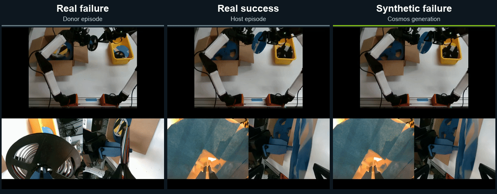

<!-- SPDX-FileCopyrightText: Copyright (c) 2026 NVIDIA CORPORATION & AFFILIATES. All rights reserved. -->
<!-- SPDX-License-Identifier: OpenMDW-1.1 -->

# FailureGen — Generate Robot Failure Videos with Cosmos3-Nano

> **Authors:** Chaitra Sathe, Akul Santhosh
> **Organization:** [NVIDIA](https://nvidia.com/)

**Description.** FailureGen reuses motion from a real robot failure in another
recorded scene, then uses a post-trained Cosmos3-Nano forward-dynamics (FD) model
to predict what happens. This recipe generates three continuations for a dual-arm
YAM robot: handover drop, pickup miss, and pickup slip. Each generated video is
compared with its recorded donor and host.

**Value.** A reader gets three synthetic videos, the actions that conditioned
them, and source/checkpoint provenance for review. The supplied adapted checkpoint
and prepared inputs let the reader run generation directly. Reviewed synthetic
clips can supplement real recordings for downstream failure detection; this
recipe ends with visual inspection and does not train a detector or measure its gain.



**Handover drop.** FailureGen transfers motion from a real handover failure (left)
into a successful host scene (center). Cosmos generates the resulting continuation
(right), where the reel drops during the handover while retaining the host's scene
and object appearance.
[Watch the MP4](assets/examples/handover_drop/handover-drop-comparison.mp4).

| Source clips                                                                                                          | Intended transfer                                            |
| --------------------------------------------------------------------------------------------------------------------- | ------------------------------------------------------------ |
| [Watch handover-drop donor](assets/examples/handover_drop/donor.mp4) · [host](assets/examples/handover_drop/host.mp4) | Donor 42 at 10.6 s → host 79 at 10.8 s; transfer both arms.  |
| [Watch pickup-miss donor](assets/examples/pickup_miss/donor.mp4) · [host](assets/examples/pickup_miss/host.mp4)       | Donor 40 at 7.2 s → host 43 at 4.4 s; transfer the left arm. |
| [Watch pickup-slip donor](assets/examples/pickup_slip/donor.mp4) · [host](assets/examples/pickup_slip/host.mp4)       | Donor 61 at 8.6 s → host 46 at 7.6 s; transfer the left arm. |

| Model                                                                                                                                                                                                                      | Workload                              | Use case                                                                                |
| -------------------------------------------------------------------------------------------------------------------------------------------------------------------------------------------------------------------------- | ------------------------------------- | --------------------------------------------------------------------------------------- |
| Adapted Cosmos3-Nano FD checkpoint, [`nvidia/failure-gen-yam-bimanual` @ `eb236695a05af0c4977554baf004162159a7bb99`](https://huggingface.co/nvidia/failure-gen-yam-bimanual/tree/eb236695a05af0c4977554baf004162159a7bb99) | Three fixed failure transfers, seed 0 | Host image, transferred robot actions, and neutral task text in; video continuation out |

## What You'll Build

- A pinned download of the adapted FD checkpoint, VAE, tokenizer, and six source
  recordings with prepared robot actions.
- Three donor/host pairs, with source clips to inspect before generation.
- Three synthetic continuations, each conditioned on 16 actions with 20 values per action.
- Side-by-side donor, host, and generated video comparisons.
- An output directory containing videos, raw and normalized actions, manifests,
  and input hashes for review and provenance.

A **donor** is a failed recording that supplies failure-associated robot motion.
A **host** is a successful recording that supplies the initial scene and nominal
motion. The **Cosmos FD model** predicts video from an initial observation, robot
actions, and task text. FailureGen changes the actions while keeping the task text
neutral. The generated outcome can be the intended failure, another failure, or success.

## Pipeline


| Stage | What happens                                                                  | GPU               |
| ----- | ----------------------------------------------------------------------------- | ----------------- |
| 1     | Download the pinned model bundle and six prepared source episodes.            | no                |
| 2     | Validate the prepared data, normalizer, checkpoint contract, and environment. | four GPUs checked |
| 3     | Prepare three fixed transfers and watch their recorded donor/host clips.      | no                |
| 4     | Generate the three continuations with the adapted Cosmos FD checkpoint.       | four GB200 GPUs   |
| 5     | Compare donor → host → generated and inspect the actual outcomes.             | no                |

For new or different data, labeling, action preparation, and FD post-training come
before this pipeline. Those steps are already complete for the supplied examples.

## Prerequisites

### Hardware

The recorded generation run used **four NVIDIA GB200 GPUs on one node**.

### Run the example

Use a compatible Cosmos framework environment with PyTorch/CUDA and `ffmpeg`.
The runtime and model loader must match framework revision
`cf5d68c00d97ccd2480a2320ed652b92dec63102`, as recorded in the checkpoint's
training contract.

From the cosmos-framework repository root, enter the recipe’s
`assets/failuregen/` directory, install the package into that Cosmos environment,
and point it at the compatible framework checkout:

```bash
cd .agents/skills/cosmos3-failuregen-yam-bimanual/assets/failuregen
export FAILUREGEN_FRAMEWORK=$(git rev-parse --show-toplevel)
python -m pip install -e ".[cosmos,notebook]"
jupyter lab
```

Run `hf auth login` with an account that has access to the private inference
bundle. Allow space for the approximately **63.6 GB** download, the Hugging Face
cache, and generated outputs.

The [Commands](#commands) section contains the Python blocks for this workflow.
Run them in order in one Jupyter kernel started from `assets/failuregen/`; they
share state and use IPython video display. Keep the optional training block
commented when using the supplied examples.

All supporting files live under `assets/`, with this README as the walkthrough:

```text
README.md
assets/
├── examples/             # Source previews and the handover-drop hero
└── failuregen/
    ├── configs/          # Fixed pairs and training configuration
    ├── docs/             # Supporting guides and validation evidence
    ├── scripts/          # Labeling, release, and Slurm scripts
    ├── src/failuregen/   # Python package, generation, and training modules
    ├── tests/            # Existing validation checks
    └── pyproject.toml    # Package installation metadata
```

### Resources

| What                                      | Address                                                                                                                                                                                |
| ----------------------------------------- | -------------------------------------------------------------------------------------------------------------------------------------------------------------------------------------- |
| Framework revision                        | [`cf5d68c00d97ccd2480a2320ed652b92dec63102`](https://github.com/NVIDIA/cosmos-framework/commit/cf5d68c00d97ccd2480a2320ed652b92dec63102)                                               |
| Inference bundle                          | [`nvidia/failure-gen-yam-bimanual` @ `eb236695a05af0c4977554baf004162159a7bb99`](https://huggingface.co/nvidia/failure-gen-yam-bimanual/tree/eb236695a05af0c4977554baf004162159a7bb99) |
| Full dataset for new preparation/training | [`nvidia/yam-bimanual-failuregen-unannotated`](https://huggingface.co/datasets/nvidia/yam-bimanual-failuregen-unannotated)                                                             |
| Application                               | [`assets/failuregen/src/failuregen/`](assets/failuregen/src/failuregen/) and [`assets/failuregen/scripts/`](assets/failuregen/scripts/)                                                |
| Fixed donor/host pairs                    | [`assets/failuregen/configs/showcase.json`](assets/failuregen/configs/showcase.json)                                                                                                   |
| Labeling and preparation                  | [Annotation guide](assets/failuregen/docs/annotation-format.md) and [generation workflow](assets/failuregen/docs/generation-workflow.md)                                               |
| Optional FD post-training                 | [Training guide](assets/failuregen/docs/fd-training.md) and [`assets/failuregen/configs/yam_eef_gb200.toml`](assets/failuregen/configs/yam_eef_gb200.toml)                             |
| Cluster launch                            | [Slurm guide](assets/failuregen/docs/slurm-notebook.md)                                                                                                                                |
| Recorded execution evidence               | [Source notebook validation](assets/failuregen/docs/notebook-validation.md)                                                                                                            |

## Dataset

| Name                    | Source                                                                                                                          | Contents                                                                                 |
| ----------------------- | ------------------------------------------------------------------------------------------------------------------------------- | ---------------------------------------------------------------------------------------- |
| Prepared example inputs | Pinned [inference bundle](https://huggingface.co/nvidia/failure-gen-yam-bimanual/tree/eb236695a05af0c4977554baf004162159a7bb99) | Episodes 40, 42, 43, 46, 61, and 79; overhead and two wrist views; prepared EEF actions. |
| Full YAM recordings     | [Unannotated dataset](https://huggingface.co/datasets/nvidia/yam-bimanual-failuregen-unannotated)                               | Recordings for separate labeling, FD training, or batch generation.                      |

The six example episodes come from the training data used to adapt the supplied
Cosmos3-Nano **forward-dynamics (FD) checkpoint**.

The source data was annotated during preparation. The compact bundle carries the
selected windows in [`assets/failuregen/configs/showcase.json`](assets/failuregen/configs/showcase.json), plus videos
and prepared actions; annotation documents are not included. The three fixed
examples require no new labeling. For the full dataset, follow the
[labeling and preparation guide](assets/failuregen/docs/annotation-format.md) before training or batch generation.

### Dataset and checkpoint contents

The download contains the following layout:

```text
failure-gen-yam-bimanual/
├── config.yaml                           # portable model config template
├── yam_training_contract.json            # original prepared-data contract
├── release.json                          # paths and export provenance
├── SHA256SUMS.json
├── checkpoints/
│   └── iter_000001243/                    # CHECKPOINT
│       ├── export.json                   # lossless export validation
│       └── model/
│           ├── .metadata
│           └── __[0-3]_0.distcp           # four FP32 regular-weight shards
├── auxiliary/
│   ├── Wan2.2_VAE.pth
│   └── tokenizer/                        # pinned Qwen tokenizer/config files
└── example_data/
    ├── dataset/                          # DATASET
    │   ├── meta/info.json
    │   └── videos/chunk-000/
    │       ├── observation.images.overhead/episode_*.mp4
    │       ├── observation.images.wrist_left/episode_*.mp4
    │       └── observation.images.wrist_right/episode_*.mp4
    └── prepared/                         # PREPARED
        ├── manifest.json
        ├── action_stats.json
        └── states/episode_*.npz
```

The bundle includes episodes **40, 42, 43, 46, 61, and 79** with all three camera
views. The original prepared manifest is retained unchanged for checkpoint
compatibility; state archives and videos are included only for these six examples.
Each archive contains `actions_raw`, `observations_eef_20d`, `source_indices`,
and `source_timestamps`. No annotation documents, synthetic output videos,
optimizer state, or EMA weights are included.

`failuregen.release.materialize_run` writes a small runtime directory under
`OUTPUT`, resolving the bundled VAE/tokenizer paths for the current machine.
The walkthrough uses that directory as `RUN_DIR`. The downloaded files and saved
data contract remain unchanged. Model weights are preserved in FP32; this
checkpoint is for inference, not resuming training.

A compatible Cosmos framework environment, PyTorch/CUDA, `ffmpeg`, and four
GB200 GPUs are still required. Those software/runtime prerequisites are not
part of the model download. Allow space for the HF cache and generated outputs.

The three fixed examples need no annotation file or labeling step. For other recordings, see the
separate [data-labeling guide](assets/failuregen/docs/annotation-format.md).

## Commands

Run these Python blocks in order in the same Jupyter kernel, starting from
`assets/failuregen/`. The optional training block remains commented.

**1. Configure paths.** Set the framework and output paths. `REPO` is the
`assets/failuregen/` package directory.

```python
import json
import os
from pathlib import Path
import sys

REPO = Path.cwd().resolve()  # launch Jupyter from assets/failuregen/
assert (REPO / "src/failuregen/workflow.py").is_file(), "Set REPO to the assets/failuregen directory"
FRAMEWORK = Path(os.environ.get("FAILUREGEN_FRAMEWORK", REPO.parent / "cosmos-framework")).expanduser().resolve()
OUTPUT = Path(os.environ.get("FAILUREGEN_OUTPUT", REPO / "outputs/three-failures")).expanduser().resolve()
NPROC = 4  # generation uses four GB200 GPUs

HF_REPO_ID = "nvidia/failure-gen-yam-bimanual"
HF_REVISION = "eb236695a05af0c4977554baf004162159a7bb99"  # verified inference bundle

EXAMPLES_DIR = OUTPUT / "showcase"
EXAMPLE_RECIPES = REPO / "configs/showcase.json"

ENV = os.environ.copy()
ENV["PYTHONPATH"] = os.pathsep.join(filter(None, [str(REPO / "src"), str(FRAMEWORK), ENV.get("PYTHONPATH")]))
ENV["PYTHONUNBUFFERED"] = "1"
ENV["PYTHONHASHSEED"] = "42"
sys.path.insert(0, str(REPO / "src"))
from failuregen.notebook import run_streamed

def run(*args, cwd=REPO):
    run_streamed(*args, cwd=cwd, env=ENV)
```

**2. Download the model and sample data.** This downloads the pinned inference
bundle and materializes a runtime configuration under `OUTPUT`. The downloaded
weights and saved data contract stay unchanged. Read the pipeline and dataset
sections while the download runs.

```python
from huggingface_hub import get_token, snapshot_download
from failuregen.release import materialize_run
if not get_token():
    raise RuntimeError("Authenticate with hf auth login before downloading this private repository")
print("Downloading the pinned inference bundle. Read section 1 while this cell runs.")
BUNDLE = Path(snapshot_download(repo_id=HF_REPO_ID, repo_type="model", revision=HF_REVISION))
release = json.loads((BUNDLE / "release.json").read_text())
DATASET = BUNDLE / release["dataset"]
PREPARED = BUNDLE / release["prepared"]
CHECKPOINT = BUNDLE / release["checkpoint"]
RUN_DIR = materialize_run(BUNDLE, OUTPUT)
print({"dataset": str(DATASET), "prepared": str(PREPARED),
       "checkpoint_bundle": str(RUN_DIR), "checkpoint": str(CHECKPOINT)})
```

**3. Optional: FD training for new or different data.** Skip this block for the
supplied examples; all its lines remain commented. Forward-dynamics training
adapts Cosmos to the robot and scene using recorded videos paired with actions.
Post-training uses video–motion pairs for forward dynamics (motion → video) and
inverse dynamics (video → motion); generation uses the forward-dynamics path.

| Preparation step        | Tool or script                                                                                                                          | Result                                                                       |
| ----------------------- | --------------------------------------------------------------------------------------------------------------------------------------- | ---------------------------------------------------------------------------- |
| Label source recordings | Separate data-labeling application + [`assets/failuregen/configs/source_labeling.json`](assets/failuregen/configs/source_labeling.json) | Failure intervals, task phases, and clean host outcomes.                     |
| Prepare robot actions   | [YAM preparation workflow](assets/failuregen/docs/generation-workflow.md#prepare-robot-actions)                                         | EEF motion, splits, and normalization statistics.                            |
| Post-train Cosmos       | [`yam_training/launch.py`](assets/failuregen/src/failuregen/yam_training/launch.py)                                                     | A model adapted to successful and failed executions.                         |
| Label generated clips   | [`prepare_labeling.py`](assets/failuregen/scripts/prepare_labeling.py) + the labeler                                                    | Import experimental batches for review; the importer does not assign labels. |

For your own data, prepare reviewed recordings and compatible EEF exports, then
set the paths in this block. Choose new compatible donor/host windows before
continuing. See the [FD training guide](assets/failuregen/docs/fd-training.md) for prerequisites.

```python
# # OPTIONAL: FD training is needed only when using new or different data.
# # The published example already has an adapted checkpoint; leave this cell commented.
# # To adapt new data, prepare reviewed recordings and a robot-compatible EEF export
# # first (docs/annotation-format.md), then uncomment this entire cell and set paths.
# # Run this before section 2b, with a fresh work/output directory and no generation running.
#
# from failuregen.fd_training import prepare_dataset_view, completed_checkpoint
# SOURCE_DATASET = Path("/path/to/new/reviewed-recordings")
# EEF_INPUT = Path("/path/to/new/frozen-eef-export")
# BASE_CHECKPOINT = Path("/path/to/Cosmos3-Nano")
# WAN_VAE = Path("/path/to/Wan2.2_VAE.pth")
# FD_WORK = Path("/path/to/new/fd-work")
# FD_RUN_NAME = "yam_notebook_eef"
# FD_RESUME = False
# FD_DATASET = prepare_dataset_view(SOURCE_DATASET, EEF_INPUT, FD_WORK)
# fd_args = ["-m", "failuregen.yam_training.launch", "--dataset", FD_DATASET,
#            "--checkpoint", BASE_CHECKPOINT, "--vae", WAN_VAE, "--work-dir", FD_WORK,
#            "--framework", FRAMEWORK, "--recipe", REPO / "configs/yam_eef_gb200.toml",
#            "--action-space", "eef", "--eef-root", EEF_INPUT / "eef",
#            "--splits", EEF_INPUT / "splits.json", "--run-name", FD_RUN_NAME,
#            "--samples-per-rank", 4, "--epochs", 4]
# run(*fd_args, "--mode", "prepare", cwd=FRAMEWORK)
# run(*fd_args, "--mode", "dryrun", cwd=FRAMEWORK)
# run(*fd_args, "--mode", "train", *(["--resume"] if FD_RESUME else []), cwd=FRAMEWORK)
# RUN_DIR = FD_WORK / "training/cosmos3_yam/fd_id" / FD_RUN_NAME
# PREPARED = FD_WORK / "prepared"
# DATASET = FD_DATASET
# CHECKPOINT = completed_checkpoint(RUN_DIR, PREPARED, DATASET)
# OUTPUT = FD_WORK / "generation"
# EXAMPLES_DIR = OUTPUT / "showcase"
# # The fixed example pairs refer to the supplied dataset. For a new dataset,
# # choose compatible donor/host windows in EXAMPLE_RECIPES before continuing.
```

**4. Validate the environment and inputs.** Confirm the four GPUs, required
modules, prepared EEF data, normalizer, and checkpoint contract before preparing
source clips. A successful model load is checked during generation.

```python
import importlib.util
import shutil

print("Kernel Python:", sys.executable)
for name, path in {"dataset": DATASET, "prepared": PREPARED, "framework": FRAMEWORK,
                   "checkpoint bundle": RUN_DIR, "checkpoint": CHECKPOINT, "output": OUTPUT}.items():
    print(f"{name}: {path}")
assert RUN_DIR is not None and CHECKPOINT is not None, "Run the download cell in section 0 first"
required = [REPO / "src/failuregen/workflow.py", DATASET / "meta/info.json",
            PREPARED / "manifest.json",
            PREPARED / "action_stats.json", RUN_DIR / "config.yaml",
            RUN_DIR / "yam_training_contract.json", CHECKPOINT / "model/.metadata",
            FRAMEWORK / "cosmos_framework/inference/args.py"]
missing = [str(path) for path in required if not path.is_file()]
assert not missing, f"Missing inputs: {missing}"
missing_modules = [name for name in ("numpy", "yaml", "PIL", "pyarrow", "av", "torch")
                   if importlib.util.find_spec(name) is None]
assert not missing_modules, f"Select the kernel for your Cosmos environment; missing: {missing_modules}"
assert shutil.which("ffmpeg"), "ffmpeg is required in the container"
run("-c", "import torch; "
    "assert torch.cuda.device_count() == 4, 'Expected four allocated GPUs'; "
    "[print(f'GPU {i}: {torch.cuda.get_device_properties(i).name}') for i in range(4)]; "
    "assert all(torch.cuda.get_device_properties(i).major >= 10 for i in range(4)), 'Expected Blackwell GPUs'")
run("-c", "from pathlib import Path; import sys; "
    "from failuregen.showcase import load_context; "
    "load_context(*(Path(p) for p in sys.argv[1:])); "
    "print('Matched EEF bundle, normalizer, and training contract: OK')",
    PREPARED, RUN_DIR)
print("Ready to prepare the three fixed examples. A successful model load is checked in the generation cell.")
```

**5. Prepare the three fixed examples.** This writes source clips and transferred
actions. No GPU inference runs yet.

```python
run("-m", "failuregen.showcase", "--prepared", PREPARED, "--dataset", DATASET,
    "--run-dir", RUN_DIR, "--checkpoint", CHECKPOINT, "--recipes", EXAMPLE_RECIPES,
    "--output", EXAMPLES_DIR)
examples = json.loads((EXAMPLES_DIR / "showcase.json").read_text())
assert examples["n_clips"] == 3
print("Prepared three failure-transfer inputs; no GPU inference has run yet.")
```

**6. Watch the donor and host first.** Each source window covers 3.2 seconds and
combines the overhead and two wrist views. Compare the object, grippers, and scene:
what goes wrong in the donor, and what does the host do differently?

```python
from html import escape
from IPython.display import HTML, Markdown, Video, display


def compare_videos(clips):
    """Show labeled video players side by side, wrapping on smaller screens."""
    cards = []
    for title, path in clips:
        player = Video(str(path), embed=True, width=360)._repr_html_()
        player = player.replace("<video ", '<video style="width:100%;height:auto" ')
        cards.append(f'<div style="flex:1;min-width:240px;max-width:480px">'
                     f'<p><strong>{escape(title)}</strong></p>{player}</div>')
    display(HTML('<div style="display:flex;gap:16px;flex-wrap:wrap">'
                 + "".join(cards) + '</div>'))


for example in examples["examples"]:
    display(Markdown(f"**{example['label'].replace('_', ' ').capitalize()}**"))
    compare_videos([
        ("Donor · real failure", EXAMPLES_DIR / example["donor_source"] / "ground_truth.mp4"),
        ("Host · real success", EXAMPLES_DIR / example["host_source"] / "ground_truth.mp4"),
    ])
```

**7. Generate all three continuations.** FailureGen retains 0.8 seconds of host
motion, blends selected arm channels into donor motion over 0.4 seconds, and then
follows the transferred segment. Unselected channels keep the host motion.
Cosmos receives the host's initial observation, 16 normalized 20-D actions, and
neutral task text. All three examples use seed 0 and one inference launch on four GPUs.
Watch the streamed log and wait for all three videos to finish.

```python
# Generate all three examples in one inference launch, using seed 0.
for job in examples["jobs"]:
    run("-m", "torch.distributed.run", "--standalone", "--nnodes=1", f"--nproc-per-node={NPROC}",
        "-m", "failuregen.cli", "--profile", EXAMPLES_DIR / "profile.yaml", "run",
        "--manifest", EXAMPLES_DIR / job["manifest"], "--out-root", EXAMPLES_DIR / job["out_root"],
        "--checkpoint", CHECKPOINT, "--seed", job["seed"], cwd=FRAMEWORK)

missing = [example["video"] for example in examples["examples"]
           if not (EXAMPLES_DIR / example["video"]).is_file()]
assert not missing, f"Missing generated clips: {missing}"
print("Generated all three videos in", EXAMPLES_DIR)
```

**8. Compare donor → host → generated.** Check whether each generated video keeps
the host scene and object appearance, whether the intended failure occurs, and
whether the outcome is clear enough to label. Successful, different, uncertain,
or visually implausible outcomes must be distinguished during review.

```python
for example in examples["examples"]:
    display(Markdown(f"**{example['label'].replace('_', ' ').capitalize()}**"))
    compare_videos([
        ("Donor · real failure", EXAMPLES_DIR / example["donor_source"] / "ground_truth.mp4"),
        ("Host · real success", EXAMPLES_DIR / example["host_source"] / "ground_truth.mp4"),
        ("Generated · inspect the outcome", EXAMPLES_DIR / example["video"]),
    ])
```

### Files this run must create

The default `OUTPUT` is `outputs/three-failures/`; `EXAMPLES_DIR` is its `showcase/`
subdirectory. New run outputs are not committed; the handover-drop hero above is
an included preview from the existing generation. `RUN_DIR` is the runtime
configuration directory returned by `materialize_run`.

| Path                                                           | What it is                                                            |
| -------------------------------------------------------------- | --------------------------------------------------------------------- |
| `RUN_DIR/config.yaml` and `RUN_DIR/yam_training_contract.json` | Runtime model configuration and matching training contract.           |
| `EXAMPLES_DIR/profile.yaml`                                    | Prepared generation profile.                                          |
| `EXAMPLES_DIR/showcase.json`                                   | Three examples, jobs, input hashes, and source/checkpoint provenance. |
| `EXAMPLES_DIR/sources/<source>/obs.png` and `ground_truth.mp4` | Initial observations and donor/host source clips.                     |
| `EXAMPLES_DIR/<run>.json` and `<run>_raw.json`                 | Normalized and raw transferred actions.                               |
| `EXAMPLES_DIR/seed0.json` and `seed0_donors.json`              | Seed-specific run and donor manifests.                                |
| `EXAMPLES_DIR/seeds/seed0/runs/<run>/synth.mp4`                | One generated continuation for each of the three pairs.               |

## Settings

| Setting               | Value                                                                                                          |
| --------------------- | -------------------------------------------------------------------------------------------------------------- |
| Checkpoint            | Adapted Cosmos3-Nano, `iter_000001243`; FP32 regular weights.                                                  |
| Embodiment            | `xdof_yam`, domain 16.                                                                                         |
| GPUs                  | Four GB200 GPUs; `NPROC = 4`.                                                                                  |
| Examples and seed     | Three fixed pairs, one seed per pair, seed 0.                                                                  |
| Sampling steps        | 30 in the saved framework profile.                                                                             |
| Action sequence       | 16 actions × 20 values, 5 Hz.                                                                                  |
| Action representation | Per arm: relative translation (3), rotation as two matrix columns (6), absolute destination gripper state (1). |
| Normalization         | Saved training quantiles, applied once, without clipping.                                                      |
| Transfer              | Retain four host actions; blend selected arm channels over two actions.                                        |
| Observation frames    | 17 including the initial frame; timestamps 0–3.2 s.                                                            |
| Camera layout         | Overhead above left and right wrist views on a 960×960 source canvas.                                          |
| Framework image tier  | `image_size=720`.                                                                                              |

Observations are sampled from 30 to 5 Hz before relative motion is computed.
Model weights are preserved in FP32. This checkpoint is for inference and does not
include optimizer state or EMA weights for resuming training.

## Results

The adapted Cosmos3-Nano **forward-dynamics (FD) checkpoint** generated three
clips: handover drop, pickup miss, and pickup slip. Each clip contains **17 frames
at 5 FPS and 960×960 resolution**, conditioned on 16 actions with 20 values each.
All three used seed 0 and 30 sampling steps on four NVIDIA GB200 GPUs.

Generating all three clips took approximately **98 seconds**, with the model and
data already downloaded.

## Examples

These pairs are fixed in [`assets/failuregen/configs/showcase.json`](assets/failuregen/configs/showcase.json).
Each window spans 3.2 seconds. The source previews are included in the repository;
the handover-drop hero includes an existing synthetic continuation. Running the
recipe generates all three synthetic videos locally.

| Failure type  | Donor episode · start | Host episode · start | Transferred arms | Seed |
| ------------- | --------------------- | -------------------- | ---------------- | ---: |
| Handover drop | 42 · 10.6 s           | 79 · 10.8 s          | left and right   |    0 |
| Pickup miss   | 40 · 7.2 s            | 43 · 4.4 s           | left             |    0 |
| Pickup slip   | 61 · 8.6 s            | 46 · 7.6 s           | left             |    0 |

### How you know it worked

- The pinned bundle resolves all required dataset, prepared-data, and checkpoint files.
- The environment check sees four Blackwell GPUs and validates the EEF normalizer
  and training contract.
- `showcase.json` reports exactly three clips and the six donor/host previews are viewable.
- Each generated `synth.mp4` exists, decodes, and displays alongside its source pair.
- The output directory retains the actions, manifests, and provenance needed to review each result.
- Actual outcomes are inspected before any generated clip is labeled as a failure.

## Prompt and agent guide

**Prompt.** Cosmos receives the neutral task caption from the selected host's
prepared manifest, together with its initial camera observation and the transferred
actions. The recipe does not replace the caption with an instruction to fail.
The caption is preserved in each prepared run manifest.

**Running this recipe with a coding agent.**

- Use the pinned model and framework in [Resources](#resources).
- Run the blocks in one persistent Python session from `assets/failuregen/`.
- Keep optional training commented when using the supplied checkpoint and examples.
- Preserve the saved data contract, normalization statistics, recipes, and seed.
- Check generated files and visually review outcomes before assigning failure labels.
- Use the separate labeling and FD-training guides when moving to new recordings.

## Known limitations

- **Private inference release.** Downloading the bundle requires repository access.
- **Four-GB200 configuration.** The recorded execution does not validate other hardware configurations.
- **Framework compatibility.** A different checkout can fail model initialization;
  the recorded first attempt failed with `Missing key flex_attention`.
- **Three fixed pairs, one seed.** This is a generation walkthrough, not a failure-rate benchmark.
- **Candidate outcomes.** Failure-associated donor motion does not guarantee the
  intended failure; generated outcomes can vary across framework and hardware versions.
- **Compact prepared subset.** The bundle preserves the original manifest but
  supplies videos and states for only six episodes, without annotation documents.
- **New data needs preparation.** New robots or scenes require compatible actions,
  model settings, and potentially FD post-training.
- **Downstream use is separate.** Labeling generated clips and training a detector
  are outside this walkthrough; no downstream gain is established by generating three clips.

## Document Information

|                        |                                                                                                                                                                                                                |
| ---------------------- | -------------------------------------------------------------------------------------------------------------------------------------------------------------------------------------------------------------- |
| Application            | [`assets/failuregen/`](assets/failuregen/), containing the scripts, package, configuration, and supporting guides.                                                                                             |
| Framework              | [`cf5d68c00d97ccd2480a2320ed652b92dec63102`](https://github.com/NVIDIA/cosmos-framework/commit/cf5d68c00d97ccd2480a2320ed652b92dec63102).                                                                      |
| Model and example data | [`nvidia/failure-gen-yam-bimanual` @ `eb236695a05af0c4977554baf004162159a7bb99`](https://huggingface.co/nvidia/failure-gen-yam-bimanual/tree/eb236695a05af0c4977554baf004162159a7bb99), approximately 63.6 GB. |
| Full dataset           | [`nvidia/yam-bimanual-failuregen-unannotated`](https://huggingface.co/datasets/nvidia/yam-bimanual-failuregen-unannotated); separate labeling and preparation required.                                        |
| Use                    | Generate three synthetic robot continuations and inspect their outcomes.                                                                                                                                       |
| Status                 | Private inference release.                                                                                                                                                                                     |
| Recorded on            | Four NVIDIA GB200 GPUs; see [Results](#results) and [validation evidence](assets/failuregen/docs/notebook-validation.md).                                                                                      |
| Walkthrough            | This README contains the complete generation workflow as Python blocks.                                                                                                                                        |
