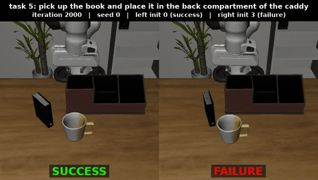

<!-- SPDX-FileCopyrightText: Copyright (c) 2026 NVIDIA CORPORATION & AFFILIATES. All rights reserved. -->
<!-- SPDX-License-Identifier: OpenMDW-1.1 -->

# Cosmos Policy — Post-Train Cosmos3-Nano into a Robot Manipulation Policy on LIBERO-10

> **Authors:** [Saeed Babamohamadi](https://www.linkedin.com/in/saeedbabamohamadi)
> **Organization:** [NVIDIA](https://nvidia.com/)

Post-train the public Cosmos3-Nano model into a robot manipulation policy on the public LIBERO-10
benchmark, evaluate it in simulation, and know what it costs on one GPU.

Cosmos 3 generates robot actions the same way it generates video: actions are one of its output
modalities. Post-training a policy is therefore a single supervised fine-tuning run on robot
demonstrations, using the recipe that ships in `cosmos-framework`. Nothing is added to the model.


*What you are watching: the post-trained Cosmos3-Nano policy driving the Franka arm in the LIBERO
simulator on task 5, "pick up the book and place it in the back compartment of the caddy", at
iteration 2000, evaluation seed 0. The two panels start from two of the 50 fixed initial states of this
task. Left: the policy picks the book, turns it and places it in the compartment in 176 control steps
(20 steps per second, so about 9 s of robot time); the panel holds its last frame once the simulator
reports success. Right: from a different initial state the same policy misses the grasp, keeps trying,
and the episode is cut off at the 520-step limit, which counts as a failure. Each policy action is a
16-step chunk returned by the policy server in 1.53 s; the video is the third-person camera the policy
sees (it also sees a wrist camera and the 8-D robot state). Over three evaluation seeds × 500 episodes
this checkpoint succeeds 95.1 ± 0.1 % of the time, so a failure like the right panel happens in about
one episode in twenty. [mp4](assets/cosmos-policy/hero_iter2000_task5_success_vs_failure.mp4),
[captions and sources](assets/cosmos-policy/captions.md).*

| Model                       | Workload                | Use case                                                                                           |
| --------------------------- | ----------------------- | -------------------------------------------------------------------------------------------------- |
| `nvidia/Cosmos3-Nano` (16B) | Post-training, full SFT | Camera images + text instruction in, 16-step action chunks out; long-horizon tabletop manipulation |

## What You'll Build

- A **Cosmos3-Nano LIBERO-10 policy** trained from the public base on public data, on one DGX Station
  GB300, using the shipped 16-GPU recipe unchanged except for batch accumulation
- A **closed-loop evaluation** in the LIBERO simulator: 10 tasks × 50 layouts, three evaluation seeds,
  per-task table
- A **success-rate curve** from the untrained base (0 %) to iteration 2000 (95.1 %), with three-seed
  points at 0, 500, 1000, 1250 and 2000, a second training run of the same recipe to show the
  training-seed spread, and the same checkpoint evaluated on a second machine
- A **cost card** for one GB300: time per iteration, memory, GPU-hours, evaluation throughput,
  checkpoint and export sizes

## Pipeline

| Stage | What happens                                                                                   | GPU                                           |
| ----- | ---------------------------------------------------------------------------------------------- | --------------------------------------------- |
| 1     | Download LIBERO-10 and check what is in it                                                     | no                                            |
| 2     | Convert the base checkpoint to the training format; run 10 training iterations as a smoke test | minutes                                       |
| 3     | Post-train 2000 iterations, checkpoint every 250                                               | 55 to 62 GB300-hours                          |
| 4     | Export a checkpoint, serve it, evaluate in simulation at three seeds                           | 2.7 to 3.5 h for three seeds run concurrently |

## Prerequisites

Install cosmos-framework once, following the
[shared setup guide](https://github.com/NVIDIA/cosmos-framework/blob/c23e51f2f157ae3e51cfcd86ebfb5464850894f2/docs/setup.md). Pick the CUDA
group that matches your driver: CUDA 13.0 needs r580 or newer; on r575 use `cu128-train`.

```bash
git clone https://github.com/NVIDIA/cosmos-framework.git
cd cosmos-framework
git checkout c23e51f2f157ae3e51cfcd86ebfb5464850894f2   # v1.2.2, the revision all numbers below were measured on
uv sync --all-extras --group=cu130-train     # or cu128-train
export LD_LIBRARY_PATH=''                    # inside NGC containers
```

Beyond the shared setup:

| Requirement                                                                             | Why                                                                                                                                                                                                                                                                                                        |
| --------------------------------------------------------------------------------------- | ---------------------------------------------------------------------------------------------------------------------------------------------------------------------------------------------------------------------------------------------------------------------------------------------------------- |
| Hugging Face login (`hf auth login`)                                                    | model, dataset and VAE are public and ungated; the login avoids download limits                                                                                                                                                                                                                            |
| `Wan-AI/Wan2.2-TI2V-5B`, file `Wan2.2_VAE.pth`, revision `921dbaf3`                     | the video tokenizer the recipe loads from `WAN_VAE_PATH`; downloaded in the command block below                                                                                                                                                                                                            |
| A second Python environment for the simulator                                           | LIBERO needs `robosuite 1.4.1`, `mujoco 2.3.7` and an older torch, which conflict with the training environment. Setup steps: [docs/action_policy_libero_posttrain.md §3](https://github.com/NVIDIA/cosmos-framework/blob/c23e51f2f157ae3e51cfcd86ebfb5464850894f2/docs/action_policy_libero_posttrain.md) |
| Headless GPU rendering (`MUJOCO_GL=egl`)                                                | the simulator renders the two camera views on the GPU without a display                                                                                                                                                                                                                                    |
| About 1 TB of disk if you keep every checkpoint, about 250 GB if you keep only the last | 35 GB base download, 166 GB per training checkpoint (full state), 30 GB per export, 0.6 GB dataset                                                                                                                                                                                                         |
| A CUDA toolkit with `nvcc` and the CCCL headers, visible as `CUDA_HOME`                 | the compiled tokenizer the cost card depends on is built ahead of time; the setup guide does not install a toolkit. `pip install nvidia-cuda-nvcc nvidia-cuda-cccl` into the venv and pointing `CUDA_HOME` at it works                                                                                     |

### Hardware

The DGX Station GB300 has one GPU, the GB300 with 256 GB of memory. Everything in this recipe runs on it.

| Configuration                 | Post-training                                                                                                                                                                                                                                                                                                      | Evaluation                                                                                                     |
| ----------------------------- | ------------------------------------------------------------------------------------------------------------------------------------------------------------------------------------------------------------------------------------------------------------------------------------------------------------------ | -------------------------------------------------------------------------------------------------------------- |
| 1× DGX Station GB300 (256 GB) | **measured, two runs**: 102 s per iteration for the first 250 iterations with the compiled tokenizer, rising to 113 s by iteration 1000 at the power cap (182 s without the compiled tokenizer); 248 GB peak before the first checkpoint write, 256 GB after; 38.4 GB300-hours to iteration 1250, about 62 to 2000 | **measured**: 34 GB per policy server, 176–179 episodes/h with 8 simulators; three seeds concurrently in 2.7 h |
| 4× H100 80 GB                 | **measured over 50 iterations**: 46.1 s per iteration at 64 samples × 8 accumulation per GPU, 65.4 GB per GPU; about 26 h and 102 GPU-hours for 2000 iterations by extrapolation                                                                                                                                   | not measured                                                                                                   |
| 8× H100 80 GB                 | full 2000-iteration Nano run not measured; Cosmos3-Edge was trained to completion on this configuration (see Beyond Nano)                                                                                                                                                                                          | runs; agrees with the GB300 harness within about two points                                                    |
| 2 nodes × 8 GPUs              | the shipped recipe's default layout (HSDP 2×8, 128 samples per GPU). Not run by us                                                                                                                                                                                                                                 | —                                                                                                              |
| 1× RTX PRO 6000 (96 GB)       | does not fit: optimizer and EMA state are about 200 GB                                                                                                                                                                                                                                                             | one card serves the policy (34 GB)                                                                             |
| 4× RTX PRO 6000               | not measured; same total memory as 4× H100 but PCIe, not NVLink                                                                                                                                                                                                                                                    | not measured                                                                                                   |

While training, the GB300 is full. Evaluate after training, not at the same time.

### GPU you need

| Step                                    | Minimum that fits                                                                        | Measured                                          | Time                                                            |
| --------------------------------------- | ---------------------------------------------------------------------------------------- | ------------------------------------------------- | --------------------------------------------------------------- |
| Training, 2000 iterations               | 4 GPUs with 80 GB each (65 GB per GPU at 64 samples × 8 accumulation), or one 256 GB GPU | 1× GB300 256 GB; 4× H100 80 GB over 50 iterations | about 62 h on one GB300; about 26 h on 4× H100 by extrapolation |
| Policy server plus simulator evaluation | one GPU with 48 GB or more (server 34 GB plus render contexts)                           | 1× GB300                                          | 2.7 to 3.5 h for three seeds                                    |

One 80 or 96 GB GPU does not fit training: optimizer and EMA state alone are about 200 GB.

## Dataset

| Name                                | Source                                                                                                      | Licence                                                    | Size   |
| ----------------------------------- | ----------------------------------------------------------------------------------------------------------- | ---------------------------------------------------------- | ------ |
| LIBERO-10 (LIBERO-Long), LeRobot v3 | [`nvidia/LIBERO_LeRobot_v3`](https://huggingface.co/datasets/nvidia/LIBERO_LeRobot_v3), folder `libero_10/` | OpenMDW-1.1, ungated; may be redistributed with the recipe | 602 MB |

Each user is responsible for checking the content of datasets and the applicable licenses and determining if suitable for the intended use.

| Property               | Value                                                          |
| ---------------------- | -------------------------------------------------------------- |
| Episodes / frames      | 379 / 101,469 at 20 fps                                        |
| Tasks                  | 10 long-horizon tabletop tasks, one text instruction each      |
| Cameras                | third-person (`image`) and wrist (`wrist_image`), 256×256 each |
| Actions in the dataset | 7-D: end-effector delta pose + gripper                         |
| Robot state            | 8-D                                                            |

What the recipe does with it: actions become 10-D (3 position, 6 rotation as rot6d, 1 gripper) relative
to the previous frame, normalised with statistics that ship in the framework; the two camera views are
placed side by side into one 256×512 image.

## Splits

| Split | Content                                                                                                                                                                                |
| ----- | -------------------------------------------------------------------------------------------------------------------------------------------------------------------------------------- |
| train | 375 of the 379 demonstrations. The loader's split rule excludes 4 episodes (ids 20, 132, 197, 215; seed 0, ratio 0.01); no validation loss is computed on them, they are simply unused |
| test  | closed-loop simulation: 10 tasks × 50 layouts, up to 520 steps per episode, seeds 0, 1, 2                                                                                              |

The policy is judged by task success in the simulator, not on held-out demonstrations.

## Post-training

The recipe is the shipped experiment `action_policy_libero_nano` with
[`examples/toml/sft_config/action_policy_libero_10_nano.toml`](https://github.com/NVIDIA/cosmos-framework/blob/c23e51f2f157ae3e51cfcd86ebfb5464850894f2/examples/toml/sft_config/action_policy_libero_10_nano.toml).

| Setting             | Value                                                                                                                                                                                                                                                                                                                                                                  |
| ------------------- | ---------------------------------------------------------------------------------------------------------------------------------------------------------------------------------------------------------------------------------------------------------------------------------------------------------------------------------------------------------------------- |
| Learning rate       | 5e-5, warm-up 500, linear decay                                                                                                                                                                                                                                                                                                                                        |
| Global batch        | 2048 samples per iteration                                                                                                                                                                                                                                                                                                                                             |
| Iterations          | 2000                                                                                                                                                                                                                                                                                                                                                                   |
| Optimizer           | FusedAdam, fp32 master weights, EMA                                                                                                                                                                                                                                                                                                                                    |
| Action heads        | initialised from scratch, 5× learning rate                                                                                                                                                                                                                                                                                                                             |
| Layout as shipped   | 16 GPUs: 128 samples per GPU, no accumulation                                                                                                                                                                                                                                                                                                                          |
| Layout on one GB300 | 128 samples × 16 accumulation steps = the same 2048 (64 × 32 if memory is short)                                                                                                                                                                                                                                                                                       |
| Tokenizer           | compiled ahead of time (`compile_tokenizer` callback), as the cost card was measured. A controlled toggle later measured the tokenizer compile itself as neutral (118.6 vs 120.3 s per iteration); the 182 s per iteration seen in the first cold run had other compile settings off as well, so the 1.8× is not attributable to the tokenizer (see Known limitations) |

Same global batch means the same optimizer trajectory; one GPU is simply 16× slower per iteration.

### Commands, one GB300

```bash
# 1. Data, base weights and video tokenizer, at the revisions every number below was measured on
hf download nvidia/LIBERO_LeRobot_v3 --repo-type dataset --include 'libero_10/**' \
  --revision e5907374380b8f96511957e6ba5582be52a1e179 --local-dir data/LIBERO_LeRobot_v3                        # 0.6 GB
export LIBERO_ROOT=$PWD/data/LIBERO_LeRobot_v3/libero_10
hf download nvidia/Cosmos3-Nano --revision e59a53c25979a090fa8706c9acc0c254a6e89b92 --local-dir hf/Cosmos3-Nano   # 35 GB
hf download Wan-AI/Wan2.2-TI2V-5B Wan2.2_VAE.pth --revision 921dbaf3f1674a56f47e83fb80a34bac8a8f203e \
  --local-dir examples/checkpoints/wan22_vae                                                                       # 2.7 GB

# 2. Base checkpoint → training format (DCP). CPU only, under 10 minutes, once. Pass the local directory: the catalog
#    name `Cosmos3-Nano` would make the converter fetch whatever `main` points at that day. (The converter still
#    contacts the Hub and keeps a cache copy of the base, so it needs network.)
python -m cosmos_framework.scripts.convert_model_to_dcp -o examples/checkpoints/Cosmos3-Nano --checkpoint-path $PWD/hf/Cosmos3-Nano
export BASE_CHECKPOINT_PATH=$PWD/examples/checkpoints/Cosmos3-Nano
export WAN_VAE_PATH=$PWD/examples/checkpoints/wan22_vae/Wan2.2_VAE.pth
export IMAGINAIRE_OUTPUT_ROOT=$PWD/outputs/train

# Overrides that turn the 16-GPU recipe into a 1-GPU run, with the compiled tokenizer the cost card needs.
# CUDA_HOME must point at a toolkit with nvcc and CCCL headers, or the compile step fails at iteration 3.
export CUDA_HOME=$PWD/.venv/lib/python3.13/site-packages/nvidia/cu13   # after: pip install nvidia-cuda-nvcc nvidia-cuda-cccl
ONE_GPU="model.config.parallelism.data_parallel_shard_degree=1 model.config.parallelism.data_parallel_replicate_degree=1 \
  dataloader_train.max_samples_per_batch=128 trainer.grad_accum_iter=16 job.wandb_mode=disabled \
  trainer.callbacks.compile_tokenizer.enabled=true trainer.callbacks.compile_tokenizer.warmup_resolutions=[256]"

# Smoke test: 10 iterations, one checkpoint. Confirms data, checkpoint and memory before the long run.
EXTRA_TAIL_OVERRIDES="$ONE_GPU trainer.max_iter=10 checkpoint.save_iter=10" \
NPROC_PER_NODE=1 bash examples/launch_sft_action_policy_libero_10_nano.sh

# 3. Full run: 2000 iterations, checkpoint every 250
EXTRA_TAIL_OVERRIDES="$ONE_GPU checkpoint.save_iter=250" \
NPROC_PER_NODE=1 bash examples/launch_sft_action_policy_libero_10_nano.sh
```

On 80 GB GPUs use `max_samples_per_batch=64` and `grad_accum_iter=32 / number of GPUs` so the global
batch stays 2048; on 4× H100 that is 64 × 8, measured at 65 GB per GPU. The first compile takes about
9 minutes; the smoke test's steady-state iterations should take about 102 s. Start the run in `tmux` or with `nohup` so it survives a dropped SSH session, and do
not wrap it in `timeout`: a checkpoint is 166 GB and takes about 3 minutes to write.

### Export, serve, evaluate

```bash
RUN=$IMAGINAIRE_OUTPUT_ROOT/cosmos3_action_libero/action_sft/action_policy_libero_10_nano

# Export: 30 GB bf16 safetensors, about 5 minutes. Enough to serve or to fine-tune further.
python -m cosmos_framework.scripts.export_model --checkpoint-path $RUN/checkpoints/iter_000002000 \
  --config-file $RUN/config.yaml -o $RUN/export_iter2000

# Policy servers: one per evaluation seed, each with its own --seed and its own port (34 GB each; three fit on one GB300).
# LIBERO_ROOT must be exported first: the server composes the training experiment, which resolves it at start-up.
mkdir -p results
for SEED in 0 1 2; do
nohup python -m cosmos_framework.scripts.action_policy_server_libero \
  --experiment action_policy_libero_nano \
  --experiment-overrides "model.config.tokenizer.vae_path=$WAN_VAE_PATH" \
  --checkpoint-path $RUN/checkpoints/iter_000002000 \
  --action-normalization quantile_rot \
  --action-stats-path cosmos_framework/data/generator/action/normalizer_stats/libero_native_frame_wise_relative_rot6d.json \
  --raw-action-dim 10 --fps 20 --port $((8000+SEED)) --seed $SEED \
  > results/server_iter2000_seed$SEED.log 2>&1 &
done

# Simulator clients, from the second environment: 500 episodes per seed, each client on its own server's port, all three at once
export MUJOCO_GL=egl
for SEED in 0 1 2; do
OUT=results/libero_10_iter2000_seed$SEED; PORT=$((8000+SEED)); mkdir -p $OUT
( for i in $(seq 1 240); do curl -sf -m 5 http://localhost:$PORT/ >/dev/null && break; sleep 15; done   # wait until this server answers
  curl -s -m 10 http://localhost:$PORT/info > $OUT/server_info.json                                   # records the seed the server uses
  PYTHONPATH=$PWD:$PWD/LIBERO .libenv/bin/python cosmos_framework/simulation/libero/closed_loop_eval.py \
    --server_url http://localhost:$PORT --task_suite libero_10 --num_trials_per_task 50 --num_envs 8 \
    --camera agentview,wrist --image_size 256 --action_space frame_wise_relative --rotation_space 6d \
    --action_dim 10 --seed $SEED --wait_timeout 1800 --output_dir $OUT > $OUT/client_stdout.log 2>&1
  pkill -TERM -f "action_policy_server_libero.*--port $PORT " ) &
done
wait
```

The server loads either the full training checkpoint (`checkpoints/iter_000002000`, as above) or the 30 GB export
directory. Every number in Results from the training station was produced from the training checkpoint; the
second-machine check (94.2 ± 1.6 %) was produced from the export, copied to that machine.

The server's `--seed` sets the sampler; the client's `--seed` alone does not give distinct evaluation
seeds. Start one server per seed on its own port (three fit on one GB300 at 34 GB each) and run the
three clients at once: 2.7 h instead of 8.5 h. Each seed writes `summary.json` with the overall success
rate and one line per task. Report the mean and spread over the three seeds and the per-task table.

If a checkpoint from iteration 1500 or later scores under 80 %, the evaluation setup is the more likely
cause than the model. Check three things: the gripper sign (the model outputs 0 to 1, the simulator
expects −1 to 1), the image orientation (simulator frames are rotated 180° relative to the training
data; the client corrects this), and that the server was started with the normalisation statistics
above. The GIFs show which of these is wrong within a few episodes.

## Results / Expected Output

Measured on one DGX Station GB300 (256 GB, driver 595, CUDA 13.2, torch 2.10), `cosmos-framework`
`c23e51f`, the recipe above, 379 demonstrations, two independent training runs. Evaluation: 10 tasks ×
50 layouts, 520 max steps, 500 episodes per evaluation seed. Entries with a ± are the mean and spread over
three evaluation seeds (sample standard deviation on the training-station tables, half the seed range on the
evaluation-bed tables, as each table states); single numbers are one evaluation seed.

| Iteration                                           | 0 (base)                | 250           | 500                  | 750                                     | 1000                 | 1250                 | 1500                 | 1750          | 2000                     |
| --------------------------------------------------- | ----------------------- | ------------- | -------------------- | --------------------------------------- | -------------------- | -------------------- | -------------------- | ------------- | ------------------------ |
| Run A, success (%)                                  | —                       | 15.6 (1 seed) | 54.2 (1 seed)        | 73 and 77 (two single-seed evaluations) | 88.4 (1 seed)        | 93.6 ± 1.4 (3 seeds) | 94.8 ± 0.4 (3 seeds) | 94.4 (1 seed) | **95.1 ± 0.1** (3 seeds) |
| Run B, success (%)                                  | **0.0 ± 0.0** (3 seeds) | —             | 48.3 ± 9.4 (3 seeds) | —                                       | 85.0 ± 2.5 (3 seeds) | 91.1 ± 1.1 (3 seeds) | —                    | —             | —                        |
| GB300-hours, cumulative (run B, compiled tokenizer) | 0                       | 7.4           | 14.9                 | 22.7                                    | 30.6                 | 38.4                 | ≈ 46                 | ≈ 54          | ≈ 62                     |

Run B is the same recipe launched from a clean machine by following this document. Its per-seed
values: 500 → 57.0 / 49.6 / 38.4; 1000 → 87.8 / 83.2 / 84.0; 1250 → 91.6 / 91.8 / 89.8. The two runs
differ by 2.5 points at iteration 1250. Treat that as the training-seed spread of this recipe: a
difference between two single runs smaller than 2.5 points is not a finding. Early checkpoints also
vary more across evaluation seeds (9.4 points at 500, 1.1 at 1250) because the policy server uses one
sampler seed for all 500 episodes.

The base model scores 0.0 % at every seed: it has no action heads for this robot, so the untrained
policy outputs noise. That is the as-is smoke test, not a baseline to beat.

**Comparison with the paper.** The [Cosmos 3 technical report](https://research.nvidia.com/labs/cosmos-lab/cosmos3/technical-report.pdf),
Table 20, reports 24.6 / 91.4 / 95.8 / 97.4 % at iterations 500 / 1000 / 1500 / 2000 on the same suite
with 500 rollouts per checkpoint. The report starts from a mid-trained initialisation; this recipe starts from the
public base with freshly initialised action heads, so the early curve is a different protocol: 54.2 (one seed) and
48.3 ± 9.4 here against 24.6 there at iteration 500, 85.0 ± 2.5 and 88.4 against 91.4 at 1000. At iteration 2000 the
single-GPU run is within about two points of the report (95.1 ± 0.1 against 97.4).

**Second machine.** The same iteration-2000 export scored 94.2 ± 1.6 % on 8× H100 with its own
simulator build, against 95.1 ± 0.1 % on the training station; another export differed by 1.7 points
between two harnesses. Compare checkpoints on one machine, one harness, the same seeds.

### What the numbers look like

Each image is the last frame of one evaluation episode from the third-person camera, evaluation
seed 0, with the task, iteration, seed and outcome burned into the frame. A success frame shows the
objects at their goal positions when the simulator's success predicate fired; a failure frame shows
where the scene stood when the 520-step limit cut the episode off. The three iteration-2000 frames
come from the 95.1 % checkpoint; the fourth is from the perturbed-scene evaluation of a separate restyle
study, not part of this recipe, so you can see what "perturbed" means: randomised lighting, table and object colours,
textures and a jittered camera, with the same initial state as the standard scene.

|                                                                                                                                                                                                                                     |                                                                                                                           |                                                                                                                                                                                                                                                                                      |                                                                                                                                                                                                                                                                                                                              |
| ---------------------------------------------------------------------------------------------------------------------------------------------------------------------------------------------------------------------------------------------------------------------------------------------------------------------------------------- | ------------------------------------------------------------------------------------------------------------------------------------------------------------------------------------------------------------------------------ | ------------------------------------------------------------------------------------------------------------------------------------------------------------------------------------------------------------------------------------------------------------------------------------------------------------------------------------------------------------------------------------- | ----------------------------------------------------------------------------------------------------------------------------------------------------------------------------------------------------------------------------------------------------------------------------------------------------------------------------------------------------------------------------------------------------------------------------------------------------------- |
| **Iteration 2000, task 1**, "put both the cream cheese box and the butter in the basket": success in 259 steps. Both objects are in the basket at the left edge of the frame and the gripper is still above it after the second place. A two-object task, so the policy has to sequence two pick-and-place motions from one instruction. | **Iteration 2000, task 7**, "put both the alphabet soup and the cream cheese box in the basket": success in 260 steps. Same structure as task 1 with different objects; the training set holds 43 demonstrations of this task. | **Iteration 2000, task 8**, "put both moka pots on the stove": failure, cut off at 520 steps. One pot is on the stove; the gripper is still holding the second above the table when the step limit hits. This task has the fewest demonstrations (29) and scores lowest at every checkpoint, which is why the per-task breakdown in the evaluation output matters more than the mean. | **Iteration 1250, perturbed scene, task 0**, "put both the alphabet soup and the tomato sauce in the basket": success in 312 steps. Note the green-tinted lighting, the darker table, the recoloured packaging and the shifted camera against the three frames to its left; the initial object positions are the same as in the standard scene. This frame is from a policy trained with restyled demonstrations in that separate study, at iteration 1250. |

No videos were saved for the base model (iteration 0) or iteration 500, so those checkpoints have numbers but no frames.

### Cost card, one GB300

| Item                                               | Value                                                                                                                                                                                                                |
| -------------------------------------------------- | -------------------------------------------------------------------------------------------------------------------------------------------------------------------------------------------------------------------- |
| Time per iteration                                 | 102 s for iterations 2–249 with the compiled tokenizer; 108 by 500, 113 by 1000 at the 1.3 kW power cap; 182 s in the first cold run before the compile settings were fixed, not attributable to the tokenizer alone |
| One-time tokenizer compile                         | about 9 minutes                                                                                                                                                                                                      |
| GPU memory during training                         | 248 GB before the first checkpoint write, 256 GB (full card) after it                                                                                                                                                |
| Host RAM during training                           | 166 GB, rising to about 410 GB used after the first checkpoint write                                                                                                                                                 |
| Checkpoint write (166 GB)                          | 200–260 s                                                                                                                                                                                                            |
| Export (30 GB)                                     | about 1 minute on CPU                                                                                                                                                                                                |
| Policy server                                      | ready in 14 s, 34 GB, 1.53 s per 16-action chunk                                                                                                                                                                     |
| Evaluation, 8 simulators                           | 176–179 episodes per hour per server; three seeds concurrently in 2.7 h for a good checkpoint, 3.5 h for a weak one (failed episodes run to the 520-step cap)                                                        |
| Evaluation utilisation                             | 48 % GPU, 4 of 72 CPU cores; the policy, not the simulator, sets the pace                                                                                                                                            |
| Base to a 90 % policy with a three-seed evaluation | 38 h training to iteration 1250 + 2.7 h evaluation, unattended; about 62 h training to 2000                                                                                                                          |

### How you know it worked

- The smoke run compiles 30 tokenizer variants, then runs at about 102 s per iteration and saves `iter_000000010` with a finite loss and about 248 GB peak memory. If it runs at about 180 s, the recipe's compile settings are not in effect; check `model.compile.enabled` and the `compile_tokenizer` callback.
- The untrained base scores 0 % in the simulator; iteration 500 scores roughly 50 %; iteration 1000 roughly 85 %.
- The policy server answers `/info` and returns a 16×10 action chunk.
- A checkpoint from iteration 1500 or later reaches 90 % or more over three seeds.
- No task in the per-task table is at 0 %.

## Beyond Nano

**Cosmos3-Edge (4B), for on-device deployment.** The same experiment trains Edge with three edits:
import `EDGE_MODEL_CONFIG` instead of `NANO_MODEL_CONFIG` in the experiment file, point
`BASE_CHECKPOINT_PATH` at a DCP conversion of `nvidia/Cosmos3-Edge`, and rename the launcher. This is
the path of the [Cosmos 3 Edge on-device tutorial](https://developer.nvidia.com/blog/post-train-nvidia-cosmos-3-edge-for-on-device-robot-control/).
Measured on 8× H100 80 GB at the same global batch of 2048 (32 samples × 8 accumulation per GPU):
16.7 s per iteration, 11.9 GB allocated per GPU, 9.3 h wall and 75.5 GPU-hours for 2000 iterations
including export. Success every 250 iterations: 0.0 / 1.5 / 16.6 / 39.2 / 53.2 / 69.0 / 78.2 /
**85.1 ± 2.7** (three evaluation seeds at 2000; five seeds 84.0 ± 4.5, per seed 85.8 / 87.4 / 82.2 /
77.0 / 87.6). Edge reaches about 85 % where Nano reaches 95 % on the same data and schedule, and its
seed spread is wider. On one GB300 Edge at batch 2048 runs at 159 s per iteration and 71 GB; on one
H100 at batch 256 at 14.9 s per iteration and 48 GB. Edge at 500 iterations with batch 256 scores
under 10 % and is not a result.

**Bring your own robot.** Convert your demonstrations to LeRobot v3 (camera video, joint state,
gripper, actions, one instruction per episode), write a dataset adapter with your action space and
normalisation statistics following
[docs/custom_dataset.md](https://github.com/NVIDIA/cosmos-framework/blob/c23e51f2f157ae3e51cfcd86ebfb5464850894f2/docs/custom_dataset.md),
and keep the same launch. As a reference point, a Cosmos3-Edge post-training on a 50-episode LeRobot
SO-101 dataset ran at 9 s per iteration on one RTX PRO 6000 (96 GB) with 16 samples per step; 6,000
iterations took 15 hours.

## Prompt and agent guide

**Prompts.** This recipe has one prompt per episode: the task instruction from the dataset (for example "put both the
alphabet soup and the tomato sauce in the basket"), passed to the policy server with every observation. Keep it exactly
as the dataset writes it; the policy was trained on those strings and a rephrased instruction is an untested input.
The LIBERO client sends the right string per task. When you bring your own robot, write one short imperative sentence
per task, use it identically in training and evaluation, and do not vary it between episodes of the same task.

**Running this recipe with a coding agent.** An agent with no prior context ran this recipe end to end from
the document alone, twice: the first pass found 37 defects in the document and its bundle, the second pass found
none. What made that work, and what to give your agent:

- Pin everything the agent cannot guess: framework commit, model and dataset revisions, the exact command block,
  the output directory layout. An agent that has to choose a version will choose a different one each run.
- Give it a stop rule and a budget in GPU-hours, and the three checks under "How you know it worked". Without a
  stop rule it keeps going past a finished result; without the checks it reports a broken run as done.
- Make it write a record per run (data, split, GPU type and count, peak memory, GPU-hours, result with seeds,
  control, leakage check) before it reports. A number without a record is not a result.
- Tell it what it may not do: delete checkpoints, change a pinned revision, write a secret to disk, enter
  generated data into a test set. Everything else it should fix itself and note in the record.
- Expect it to hit the deviations listed under Known limitations; they are the ones a careful reader hits too.
- For this recipe specifically, the two mistakes an agent made before the fixes were applied: running the eager
  recipe without its compile settings (182 s per iteration, cost card wrong) and seeding only the client (one sampler seed for all 500 episodes). Both are
  now in the command block; check the agent kept them.

## Known limitations

- **No zero-shot capability.** The untrained base scores 0.0 %; iteration 250 is the first useful number.
- **One training seed per run.** Two runs of the recipe differ by 2.5 points at iteration 1250; the ± values are evaluation-seed spread only.
- **Evaluation harnesses differ by one to two points** on the same export. Fix the machine, the harness and the seeds for any comparison.
- **The policy server applies one sampler seed to all 500 episodes** of an evaluation, so a single evaluation seed is one noise draw; weak checkpoints vary by up to 9 points across seeds. Always report three or more seeds with per-seed values.
- **Normalisation statistics ship with the framework** and were computed on a four-suite LIBERO mixture, not on this training split; they differ from the libero_10 statistics by up to 0.18 at the 1 % quantile on the z axis. The recipe uses them unchanged because the evaluation server does too.
- **Fewer demonstrations.** Compare at matched passes per demonstration, not at matched iterations. With 95 demonstrations the recipe reaches 75.8 % at 500 iterations (about 18 passes per demo; two training seeds agree, 75.8 ± 0.2 and 75.8 ± 1.9). With 190 demonstrations at the same 18 passes (1000 iterations) it reaches 90.4 ± 0.7 (90.4 / 89.6 / 91.2); the curve is 8.9 ± 0.8 (250), 62.0 ± 1.1 (500), 87.9 ± 1.2 (750), 90.4 ± 0.7 (1000). Doubling the data adds about 15 points at matched passes. At a fixed 500 iterations the 190-demo run scores lower (60.4 ± 1.0 and 62.0 ± 1.1, two training seeds) only because each demonstration is seen half as often. 8× GB200 per cell, 31.4 GPU-hours for the 1000-iteration run.
- **LoRA as shipped underfits.** Rank 16 adapters on the generation projections with trainable action heads reach 8.9 % at 2000 iterations against 75.8 % for full SFT on a quarter of the data; the LoRA injector also freezes freshly initialised action heads unless patched. Use full SFT.
- **One GPU is 16× slower per iteration than the shipped 16-GPU layout,** at the same result.

## Document Information

|                      |                                                                                                                                                                       |
| -------------------- | --------------------------------------------------------------------------------------------------------------------------------------------------------------------- |
| Framework            | `cosmos-framework` `c23e51f2f157ae3e51cfcd86ebfb5464850894f2` (v1.2.2)                                                                                                |
| Model                | `nvidia/Cosmos3-Nano` (public, ungated), revision `e59a53c25979a090fa8706c9acc0c254a6e89b92`                                                                          |
| Video tokenizer      | `Wan-AI/Wan2.2-TI2V-5B`, file `Wan2.2_VAE.pth`, revision `921dbaf3f1674a56f47e83fb80a34bac8a8f203e`                                                                   |
| Data                 | `nvidia/LIBERO_LeRobot_v3`, revision `e5907374380b8f96511957e6ba5582be52a1e179`, OpenMDW-1.1                                                                          |
| Measured on          | one DGX Station GB300 (two training runs, one at a time); a second machine with 4× and 8× H100; 8× GB200 for the minimum-data and LoRA cells; 2026-09-19 → 2026-10-06 |
| Post-trained exports | `nvidia/cosmos3-nano-libero10-sft-exports` (iter1000/, iter2000/, 31.5 GB each)                                                                                       |
