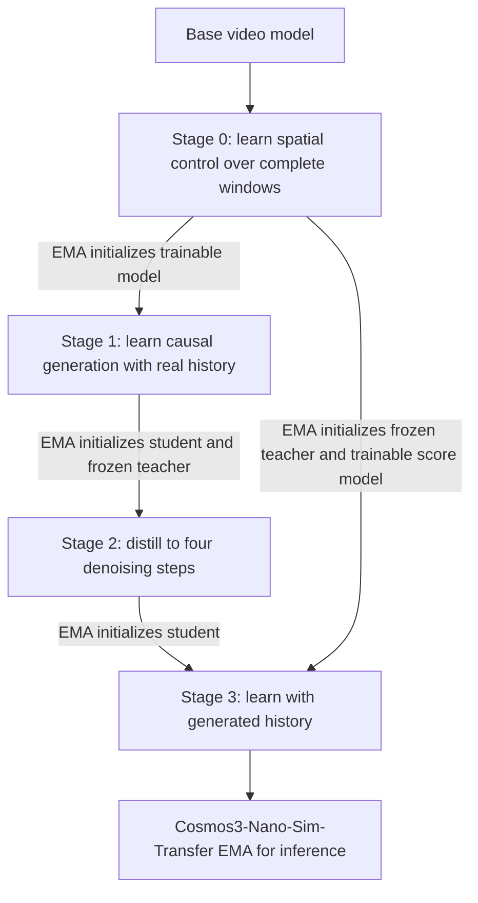

# Cosmos3-Nano-Sim-Transfer: choose a task

Cosmos3-Nano-Sim-Transfer turns a spatial control video and caption into RGB
video. Start with the [four-modality Quick Start](quick-start.md), which uses
[Hugging Face `example2`](hf-sample.md) for captioning, local data preparation,
Stage 0–3 training and inference. Native training and inference derive edge
and blur from its RGB; depth and segmentation are supplied as aligned videos.
The sample's structured JSON contains the dense `temporal_caption` used by
the 93:7 caption recipe.

Use `example1` for [long-rollout depth or segmentation inference](../inference/SKILL.md#run-example1-long-rollout).
Its 600-frame source is preserved at 30 FPS.

- [Run Stage 0–3 with local data](../post-training/references/local-training.md), including Nano conversion, checkpoint handoffs and resume.
- [Extend training](../post-training/references/local-training.md#framework-training-entry-points) with the native recipes and your own checkpoints.
- [Write prompts and prepare captions](prompt-guide.md) for the target RGB.
- [Prepare a dataset](local-dataset.md) with aligned RGB, controls and captions.
- [Generate a video with an existing model](../inference/SKILL.md).
- [Diagnose a loading or output problem](../troubleshooting/SKILL.md).

The full training workflow starts at Stage 0. Inference starts from an
existing matching checkpoint: either an HF export or native Stage 3 DCP.
Commands use the Framework checkout from [setup](setup.md).
The Skill bundle can live outside that checkout. Required model resources
and example assets are available through the documented Hugging Face downloads.

## How the training models relate

A **teacher model** supplies a learning target. Stage 2 uses the causal model
from Stage 1 as its teacher. Stage 3 uses the bidirectional model from Stage 0.
**Teacher forcing** is a different concept: providing real earlier RGB frames
during training. The trainable score model in Stage 3 starts from the same
weights as its teacher but subsequently learns from the student's samples.

## Terms used in the recipe

| Term                                           | Meaning                                                                                                                                                    |
| ---------------------------------------------- | ---------------------------------------------------------------------------------------------------------------------------------------------------------- |
| Bidirectional / causal                         | Process a complete window together / predict using the current control and preceding frames                                                                |
| Teacher forcing (TF)                           | Train with real RGB history rather than the model's generated history                                                                                      |
| Discrete consistency distillation (dCM)        | Learn a small, fixed set of denoising transitions from a frozen teacher                                                                                    |
| Distribution matching distillation (DMD)       | Train generated samples toward the teacher's distribution using teacher and learned score estimates                                                        |
| Self-forcing (SF)                              | Train on the student's own generated history to expose it to its inference conditions                                                                      |
| Fake score                                     | The trainable score estimator for student-generated samples. It is not the frozen teacher                                                                  |
| Variational score distillation (VSD)           | The student loss guided by teacher and fake-score estimates. Some implementations label its multiplier SID                                                 |
| Classifier-free guidance (CFG)                 | A strength controlling conditional versus unconditional model predictions. Teacher training guidance and student inference guidance are different settings |
| Exponential moving average (EMA)               | Smoothed model weights, selected here for model handoffs and inference                                                                                     |
| Rectified flow (RF) / stochastic sampler (SDE) | The dense denoising method used in earlier training models / the fixed stochastic schedule used by the distilled model                                     |
| Video autoencoder (VAE), latent                | The encoder/decoder and its compressed video representation                                                                                                |
| Chunk                                          | Number of latent frames predicted together. One in this causal recipe                                                                                      |
| Attention sink                                 | Initial history entries retained while a finite cache rotates recent history                                                                               |
| Replay                                         | Process completed clean RGB again so it becomes history for later predictions                                                                              |
| Prefix latents                                 | Real RGB supplied at the start of a training window. Distinct from a spatial control                                                                       |
| KV cache                                       | Attention keys and values stored from earlier predictions                                                                                                  |
| Rotary positional embedding (RoPE)             | A representation of token positions. Its time index continues when history is evicted                                                                      |
| Data / context / guidance parallelism          | Distribute examples / tokens within an example / conditional and unconditional branches across devices                                                     |
| FSDP                                           | Fully sharded data parallelism: distribute model and optimizer state across devices                                                                        |
| Fetch size                                     | Number requested from a child data loader before packing. Not necessarily the emitted batch                                                                |
| Global batch                                   | Examples contributing to one optimizer update across data-parallel replicas and accumulation                                                               |
| Warm start / resume                            | Initialize from weights with fresh training state / continue the same optimization with saved state                                                        |
| Model-native output                            | Video at the model's own canvas dimensions, before delivery resizing                                                                                       |
