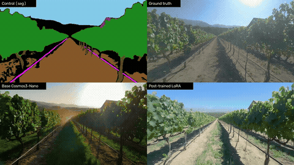
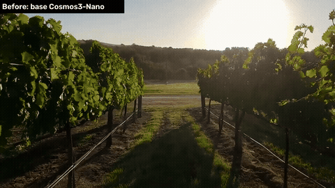
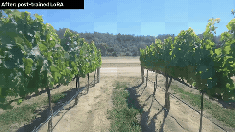
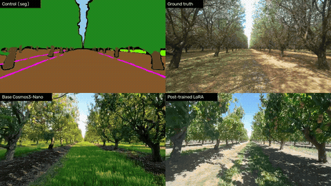
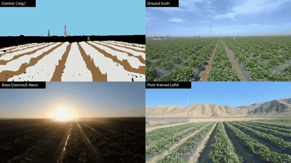

<!-- SPDX-FileCopyrightText: Copyright (c) 2026 NVIDIA CORPORATION & AFFILIATES. All rights reserved. -->
<!-- SPDX-License-Identifier: OpenMDW-1.1 -->

# Multi-control transfer LoRA for Cosmos3-Nano on an open vineyard driving dataset: image, segmentation and depth to video

> **Authors:** Sandeep Sam Zachariah (Bonsai Robotics), Paula Ramos (NVIDIA)
> **Organization:** Bonsai Robotics, NVIDIA
> **Status:** draft, 2026-10-20. Training measured on 8× A100-80GB, inference on 1× RTX PRO 6000 (96 GB).
> Reference run written into this file: yes.

You post-train one LoRA on Cosmos3-Nano that turns a seed image, a segmentation video, a depth video, or
segmentation + depth together into a 720p driving video of an agricultural field. You train on 50 ten-second
clips from a front camera on a farm robot in a vineyard, and score the held-out day against the released
base checkpoint. From the numbers you can decide whether a small, single-domain dataset is enough to pull the
model's appearance toward your own camera and site. It does not cover training a driving policy, training on
generated video, other camera rigs, or real-time generation.

| Model                                                                        | Workload                      | Use case                                                                                                         |
| ---------------------------------------------------------------------------- | ----------------------------- | ---------------------------------------------------------------------------------------------------------------- |
| `nvidia/Cosmos3-Nano` at revision `e59a53c25979a090fa8706c9acc0c254a6e89b92` | Post-training (LoRA, rank 32) | Seed image, seg video and/or depth video + caption → 720p, 15 fps video of a robot driving through vineyard rows |

## Hero result

[](assets/transfer_multicontrol_lora_nano/hero.mp4)

[Open the hero video (MP4)](assets/transfer_multicontrol_lora_nano/hero.mp4)

**Caption.** Held-out sample `vineyard_test_002`, segmentation + depth controls with the text prompt "Front-facing
camera on a farm robot driving between rows of grapevines in a vineyard. The camera moves steadily forward, straight
down the row. Clear morning sunlight, sun ahead of the camera, backlit scene.", seed 2026, 720p, 61 frames at
15 fps. Top: segmentation control and ground truth. Bottom: base Cosmos3-Nano and the post-trained LoRA (iteration
150), same controls, caption and seed. The post-trained LoRA matches the real dry, sunlit ground and sky; the base
model renders a green, sunset-lit vineyard. It is the first straight-row clip of the six-clip eval panel, a typical
run down a row; the Results tables are the aggregate.

## What you'll build

- One LoRA (rank 32, about 0.4 GB with optimizer state) that serves four modes from one checkpoint: seed image → video,
  seg → video, depth → video, seg + depth → video.
- Cost card: 150 iterations on 1 node of 8× A100-80GB at 74.6 s/iteration, about 3.5 h (≈ 28 GPU-hours) including
  setup and validation; 46 GB median / 51 GB p95 per GPU. The reference run trained 200 iterations on the same
  schedule (4 h 37 min); this recipe stops at 150, its lowest validation loss. Inference: about 2.5–3 min per
  generation on one RTX PRO 6000.
- A check against the released base checkpoint on 6 held-out clips × 4 modes, same seed and settings.
- The checkpoint this recipe produces is released as [`BonsaiRobotics/bonsai-vineyard-sample-lora`](https://huggingface.co/BonsaiRobotics/bonsai-vineyard-sample-lora) (CC BY-NC 4.0); download it to skip stages 3 and 4.
- A hero video and a matched before/after comparison.
- A stretch check on 2 orchard and 2 strawberry-bed clips the LoRA never saw.
- Data: a small sample dataset (one camera rig, one vineyard, daylight only), so the numbers show what 50 clips can do
  rather than the best this recipe can reach. One seed per sample. Dataset licence: CC BY-NC 4.0, non-commercial use only.

## Pipeline

| Stage | What happens                                                                                                                          | GPU                          |
| ----- | ------------------------------------------------------------------------------------------------------------------------------------- | ---------------------------- |
| 1     | Download the dataset and the Wan2.2 VAE, convert Cosmos3-Nano to DCP. Inspect the JSONLs. Quote the licence from the dataset card.    | no                           |
| 2     | Smoke test: one seg + depth generation with the base checkpoint on the smoke clip, scored against the ground truth.                   | ~10 min, 1 GPU               |
| 3     | Post-train the LoRA: 150 iterations of a 200-iteration cosine schedule, checkpoint every 25 and validation every 50 iterations.       | ~3.5 h, 8× A100-80GB         |
| 4     | Export iteration 150 to safetensors. Smoke test it: it loads, and the smoke clip generates and scores finite numbers.                 | ~15 min CPU + ~10 min, 1 GPU |
| 5     | Generate the held-out panel (48) and the stretch clips (16) with base and post-trained checkpoints, score them, regenerate the media. | ~3 h on 1 GPU                |

Every command runs from the cosmos-framework root. The evaluation helpers live in
`examples/transfer_multicontrol_lora_nano/`.

```bash
R=examples/transfer_multicontrol_lora_nano
RUN_DIR=outputs/train/cosmos3/sft/transfer_multicontrol_lora_nano
INFER="python -m cosmos_framework.scripts.inference --parallelism-preset=latency --no-guardrails --seed 2026"

# Stage 1: data, VAE, base checkpoint (defaults match the launcher)
uvx hf@latest download BonsaiRobotics/bonsai-vineyard-sample --repo-type dataset --local-dir examples/data/bonsai-vineyard-sample
uvx hf@latest download Wan-AI/Wan2.2-TI2V-5B Wan2.2_VAE.pth --local-dir examples/checkpoints/wan22_vae
python -m cosmos_framework.scripts.convert_model_to_dcp -o examples/checkpoints/Cosmos3-Nano --checkpoint-path Cosmos3-Nano
uv pip install lpips scikit-image imageio-ffmpeg        # evaluation helpers only
export DATASET_PATH=examples/data/bonsai-vineyard-sample

# Stage 2: smoke test the base checkpoint
python $R/make_specs.py "$DATASET_PATH" outputs/eval/smoke --set smoke
$INFER -i outputs/eval/smoke/specs/*.json -o outputs/eval/smoke/base --checkpoint-path Cosmos3-Nano
python $R/score.py "$DATASET_PATH" outputs/eval/smoke --models base

# Stage 3: post-train
bash examples/launch_sft_transfer_multicontrol_lora_nano.sh
#   Smoke run of the training path first (~25 min: three streams load, validation runs, a checkpoint saves):
#   EXTRA_TAIL_OVERRIDES="trainer.max_iter=10 checkpoint.save_iter=10" bash examples/launch_sft_transfer_multicontrol_lora_nano.sh

# Stage 4: export iteration 150, smoke test it
python -m cosmos_framework.scripts.export_model --checkpoint-path $RUN_DIR/checkpoints/iter_000000150 \
    --config-file $RUN_DIR/config.yaml --no-vit -o $RUN_DIR/model
$INFER -i outputs/eval/smoke/specs/*.json -o outputs/eval/smoke/lora --checkpoint-path $RUN_DIR/model
python $R/score.py "$DATASET_PATH" outputs/eval/smoke

# Or skip stages 3 and 4 with the released checkpoint (then use it as $RUN_DIR/model below):
#   uvx hf@latest download BonsaiRobotics/bonsai-vineyard-sample-lora --local-dir $RUN_DIR/model

# Stage 5: held-out panel and stretch clips, scores, media
for SET in panel stretch; do
    python $R/make_specs.py "$DATASET_PATH" outputs/eval/$SET --set $SET
    $INFER -i outputs/eval/$SET/specs/*.json -o outputs/eval/$SET/base --checkpoint-path Cosmos3-Nano
    $INFER -i outputs/eval/$SET/specs/*.json -o outputs/eval/$SET/lora --checkpoint-path $RUN_DIR/model
    python $R/score.py "$DATASET_PATH" outputs/eval/$SET
done
python $R/make_media.py "$DATASET_PATH" outputs/eval/panel outputs/eval/stretch docs/assets/transfer_multicontrol_lora_nano
```

`--no-guardrails` matches the reference outputs; leave it out to run the guardrails, which can change the pixels of
clips that show people.

## Prerequisites

Install cosmos-framework once, following the
[shared setup guide](setup.md). Use the guide's recommended base
image or the Docker container; on a machine without the CUDA toolkit, `transformer_engine` fails to import until you
install it (see the guide's [CUDA Issue](setup.md#cuda-issue)).

```bash
git clone https://github.com/NVIDIA/cosmos-framework.git
cd cosmos-framework
git checkout 7306dc9c2f99ffecc065006c9813482f70f030e9   # [BLOCKED: becomes the commit that contains this recipe]
uv sync --extra train --group cu128-train    # A100 on driver r575; cu130-train on newer drivers
export LD_LIBRARY_PATH=''
```

| Requirement                       | Why                                                                                                                                                                                                                                                                                                                                                               |
| --------------------------------- | ----------------------------------------------------------------------------------------------------------------------------------------------------------------------------------------------------------------------------------------------------------------------------------------------------------------------------------------------------------------- |
| 8× A100-80GB (one node)           | Measured peak 51 GB per GPU (p95) with selective activation checkpointing; without it the first step needs > 80 GB                                                                                                                                                                                                                                                |
| 1× GPU with ≥ 80 GB for inference | Measured on RTX PRO 6000 96 GB                                                                                                                                                                                                                                                                                                                                    |
| Hugging Face access               | `nvidia/Cosmos3-Nano` (not gated), `Wan-AI/Wan2.2-TI2V-5B` (VAE), [`BonsaiRobotics/bonsai-vineyard-sample`](https://huggingface.co/datasets/BonsaiRobotics/bonsai-vineyard-sample); optionally the released checkpoint [`BonsaiRobotics/bonsai-vineyard-sample-lora`](https://huggingface.co/BonsaiRobotics/bonsai-vineyard-sample-lora) (29 GB). None are gated. |
| ~200 GB disk                      | Base weights + DCP conversion (~35 GB each), dataset (1.9 GB), 6 LoRA checkpoints, one export (~31 GB)                                                                                                                                                                                                                                                            |
| `/dev/shm` ≥ 200 GB               | The seg/depth loaders pass ~1.35 GB samples through shared memory (the launcher warns below that)                                                                                                                                                                                                                                                                 |

```bash
export COSMOS_FRAMEWORK_DIR=/path/to/cosmos-framework
cd "$COSMOS_FRAMEWORK_DIR"
# Post-training: bash examples/launch_sft_transfer_multicontrol_lora_nano.sh
#   DATASET_PATH (default examples/data/bonsai-vineyard-sample) is the downloaded dataset as is;
#   BASE_CHECKPOINT_PATH defaults to examples/checkpoints/Cosmos3-Nano. Export either to override.
```

## Dataset

| Name                     | Source                                                                                                           | Licence                                                                                                                                                                                                                                                                                                                                           | Size                                                                                                |
| ------------------------ | ---------------------------------------------------------------------------------------------------------------- | ------------------------------------------------------------------------------------------------------------------------------------------------------------------------------------------------------------------------------------------------------------------------------------------------------------------------------------------------- | --------------------------------------------------------------------------------------------------- |
| Bonsai Vineyard (Sample) | [`BonsaiRobotics/bonsai-vineyard-sample`](https://huggingface.co/datasets/BonsaiRobotics/bonsai-vineyard-sample) | [CC BY-NC 4.0](https://creativecommons.org/licenses/by-nc/4.0/), non-commercial use only. From the card: “Released under the Creative Commons Attribution-NonCommercial 4.0 International licence (CC BY-NC 4.0). You may share and adapt the data for non-commercial purposes, with credit to Bonsai Robotics. Commercial use is not permitted.” | 136 clips: 50 train, 32 validation, 50 held-out, 4 stretch; 150 frames each at 15 fps, 720p; 1.9 GB |

Each clip is 10 s (150 frames at 15 fps, 1280×720) from a front camera on a farm robot, with a segmentation video
(per-pixel classes drawn as fixed colours; the legend is on the dataset card), a depth video (8-bit inverse depth,
near = bright) and one caption describing the scene, the motion (straight, turn, swerve) and the light. The JSONLs sit
at the dataset root and follow [docs/dataset_jsonl.md](dataset_jsonl.md):
`vision.jsonl` (the RGB clips) and `seg.jsonl` / `depth.jsonl` (the same clips with `control_path`), with `val_`,
`test_` and `stretch_` versions. Clip paths are relative to the root, so `DATASET_PATH` is the downloaded folder. The
experiment file `cosmos_framework/configs/base/experiment/sft/transfer_multicontrol_lora_nano.py` is the authority for
frames, resolution and conditioning.

| Split      | Content                                                                                                                                                                                                                                                                                        |
| ---------- | ---------------------------------------------------------------------------------------------------------------------------------------------------------------------------------------------------------------------------------------------------------------------------------------------- |
| Smoke      | One held-out clip, `vineyard_test_021`, seg + depth only (`make_specs.py --set smoke`). An install check, not a result.                                                                                                                                                                        |
| Train      | 50 clips from 18 recordings on three days: 25 straight, 20 turns, 5 curves.                                                                                                                                                                                                                    |
| Validation | 32 clips from 8 other recordings on two of the same days, chosen turn-rich.                                                                                                                                                                                                                    |
| Held-out   | 50 clips from every recording of a fourth day, never seen in training. The eval panel is 6 of them (3 straight, 3 turn), `vineyard_test_000`, `002`, `005`, `009`, `021`, `027`, chosen before any output was generated and pinned by the `eval_panel` column of the dataset's `metadata.csv`. |
| Stretch    | 4 clips from crops not in training: `orchard_stretch_000`, `001` and `strawberry_stretch_000`, `001` (`stretch` split). The strawberry clips have labels and depth on every 5th frame, filled in between with optical flow (see the dataset card).                                             |

Leakage check: the held-out split is a whole separate day; no recording appears in two splits; train and
validation clips are cut from different recordings. Clips within one recording can overlap by a few seconds
(132 vineyard clips ≈ 12.5 min of unique footage). The training data of the base model is not checked.

## Settings

| Setting                      | Value                                                                                                                                                                                                                                                                                                                                                                                                                  |
| ---------------------------- | ---------------------------------------------------------------------------------------------------------------------------------------------------------------------------------------------------------------------------------------------------------------------------------------------------------------------------------------------------------------------------------------------------------------------- |
| Framework                    | cosmos-framework `7306dc9c2f99ffecc065006c9813482f70f030e9` [BLOCKED: recipe commit]                                                                                                                                                                                                                                                                                                                                   |
| Checkpoint revision          | `nvidia/Cosmos3-Nano` @ `e59a53c25979a090fa8706c9acc0c254a6e89b92`                                                                                                                                                                                                                                                                                                                                                     |
| Config                       | `examples/toml/sft_config/transfer_multicontrol_lora_nano.toml`                                                                                                                                                                                                                                                                                                                                                        |
| Training                     | LoRA rank 32 / alpha 64 on the generation tower (attention q/k/v/o + MLP); lr 5e-4, 50 warm-up steps, cosine schedule over 200 iterations, stopped at 150; 3 streams on 8 GPUs in ratio 3:3:2 (RGB 150 frames: 70% image→video, 20% text→video, 10% video→video; seg and depth 61 frames, 50% with the first frame given); 720p; checkpoint every 25, validation every 50 (12 batches, `trainer.validation_seed` 2026) |
| Chosen checkpoint            | Iteration 150, the final one: the lowest validation loss over a 200-iteration run on the same schedule                                                                                                                                                                                                                                                                                                                 |
| Denoising steps / guidance   | 35 steps, shift 10. Seed image → video: guidance 6. Control modes: guidance 3, control guidance 0.9, weight 1.0 per control                                                                                                                                                                                                                                                                                            |
| Resolution                   | 720p (1280×720), 15 fps. Seed image → video: 149 frames; control modes: 61 frames (one chunk, the trained length)                                                                                                                                                                                                                                                                                                      |
| Seed                         | 2026 (inference), one seed per sample                                                                                                                                                                                                                                                                                                                                                                                  |
| What was left at the default | Sampler (UniPC), negative prompt, prompt upsampling off, Wan2.2 VAE, FSDP settings, optimizer betas                                                                                                                                                                                                                                                                                                                    |

## Results

Measured on 1× RTX PRO 6000, 2026-10-13, held-out split only (6 clips, 3 straight / 3 turn), one seed.
The control is the released base checkpoint with identical inputs and settings. Mean ± std over the 6 clips.

| Mode                | Metric      | Control (base) | This run (post-trained) | Clips improved |
| ------------------- | ----------- | -------------- | ----------------------- | -------------- |
| Seg + depth → video | PSNR (dB) ↑ | 11.82 ± 1.39   | **15.65 ± 1.20**        | 6 / 6          |
|                     | SSIM ↑      | 0.364 ± 0.047  | **0.444 ± 0.018**       | 6 / 6          |
|                     | LPIPS ↓     | 0.463 ± 0.031  | **0.323 ± 0.037**       | 6 / 6          |
| Seg → video         | PSNR (dB) ↑ | 12.13 ± 1.53   | **15.30 ± 1.17**        | 6 / 6          |
|                     | SSIM ↑      | 0.370 ± 0.040  | **0.431 ± 0.040**       | 6 / 6          |
|                     | LPIPS ↓     | 0.466 ± 0.026  | **0.332 ± 0.014**       | 6 / 6          |
| Depth → video       | PSNR (dB) ↑ | 12.31 ± 1.46   | **15.32 ± 0.84**        | 5 / 6          |
|                     | SSIM ↑      | 0.386 ± 0.040  | **0.440 ± 0.016**       | 5 / 6          |
|                     | LPIPS ↓     | 0.476 ± 0.046  | **0.334 ± 0.028**       | 6 / 6          |
| Seed image → video  | PSNR (dB) ↑ | 19.27 ± 1.56   | 19.39 ± 1.68            | 4 / 6          |
|                     | SSIM ↑      | 0.506 ± 0.024  | 0.491 ± 0.022           | 0 / 6          |
|                     | LPIPS ↓     | 0.333 ± 0.063  | 0.318 ± 0.060           | 6 / 6          |

PSNR and SSIM on 640×360 grey frames, LPIPS (AlexNet) on 448×256 colour frames, every 2nd frame, generated
vs ground-truth frame by frame (61 frames for control modes, 149 for seed image). Script:
`examples/transfer_multicontrol_lora_nano/score.py`; per-clip numbers in `metrics.csv`, summary in
[`metrics_panel.json`](assets/transfer_multicontrol_lora_nano/metrics_panel.json) and
[`metrics_stretch.json`](assets/transfer_multicontrol_lora_nano/metrics_stretch.json).

Appearance, mean over the same clips (absolute difference from the ground truth in mean HSV saturation and
brightness, 0–255):

| Mode                | Saturation gap, base → post-trained | Brightness gap, base → post-trained |
| ------------------- | ----------------------------------- | ----------------------------------- |
| Seed image → video  | 2.6 → 2.0                           | 7.2 → 5.2                           |
| Seg → video         | 71.0 → 28.8                         | 52.5 → 17.6                         |
| Depth → video       | 67.0 → 31.1                         | 49.1 → 20.5                         |
| Seg + depth → video | 73.6 → 30.7                         | 54.5 → 19.9                         |

Validation loss (flow-matching, 12 fixed batches; `avg_final_loss` in the training log), on a run taken on to 200
iterations: 0.1322 at iteration 0 (base), 0.1289 at 50, 0.1321 at 100, **0.1206 at 150**, 0.1243 at 200.

**Reading.** The controls fix the scene layout, so for the three control modes a frame-by-frame comparison with the
real clip is meaningful. There the post-trained LoRA is closer to the ground truth on every metric, by
3.0–3.8 dB PSNR and 0.13–0.14 LPIPS, on 17–18 of 18 clip × mode pairs, with a smaller spread across clips. The
change is mostly appearance: the base model renders a generic low-sun vineyard (saturation gap 67–74,
brightness gap 49–55), the post-trained one the site's bright, dry daylight (gaps 18–31). It does not show that
geometry is followed more closely; both checkpoints follow the controls, and camera motion from optical flow
matches the ground truth for both (0.97× base, 1.05× post-trained). For seed image → video the seed frame
already fixes the look, and the two checkpoints are within noise (PSNR +0.1 dB, LPIPS −0.015, SSIM −0.015).
One seed and six clips: the spread is across clips, not across seeds.

### Before and after post-training

| Before — released base checkpoint                                                                                                                | After — post-trained checkpoint                                                                                                                        |
| ------------------------------------------------------------------------------------------------------------------------------------------------ | ------------------------------------------------------------------------------------------------------------------------------------------------------ |
| [](assets/transfer_multicontrol_lora_nano/before.mp4) | [](assets/transfer_multicontrol_lora_nano/after.mp4) |
| [Open before video](assets/transfer_multicontrol_lora_nano/before.mp4)                                                                           | [Open after video](assets/transfer_multicontrol_lora_nano/after.mp4)                                                                                   |

[Open the synchronized side-by-side comparison](assets/transfer_multicontrol_lora_nano/before-after.mp4)

**Comparison caption.** Held-out sample `vineyard_test_021`, base `nvidia/Cosmos3-Nano@e59a53c2` vs the
exported LoRA at iteration 150, seed 2026, seg + depth controls, no seed frame, 35 steps, guidance 3, control
guidance 0.9, 720p, 61 frames at 15 fps. The base checkpoint renders a low-sun, golden-hour vineyard with
grassy rows; the post-trained checkpoint renders the site's bright, dry daylight and bare-soil rows from the
same controls. Neither renders the buildings marked in the segmentation at the end of the row. The sample was
selected before any output was generated. It is one clip; the tables above are the aggregate.

### Beyond the training domain (stretch check)

Same protocol on the 4 `stretch` clips, from crops the LoRA never saw (2 orchard, 2 strawberry beds), seed image →
video and seg + depth → video only. Mean over 2 clips per crop:

| Crop, mode                   | PSNR (dB), base → post-trained | LPIPS, base → post-trained | Saturation gap | Brightness gap |
| ---------------------------- | ------------------------------ | -------------------------- | -------------- | -------------- |
| Strawberry beds, seg + depth | 11.57 → **14.61**              | 0.600 → **0.539**          | 9.0 → 8.1      | 61.5 → 6.7     |
| Orchard, seg + depth         | 10.27 → **11.21**              | 0.510 → **0.466**          | 69.4 → 11.0    | 33.5 → 3.3     |
| Strawberry beds, seed image  | 19.62 → 19.58                  | 0.163 → 0.161              | 4.5 → 4.2      | 2.9 → 2.4      |
| Orchard, seed image          | 14.73 → 14.36                  | 0.361 → 0.359              | 4.5 → 6.8      | 10.9 → 8.4     |

The post-trained checkpoint keeps each crop's structure (trees, plastic-mulch beds) from the controls and carries
the daylight look over; with a seed image the seed frame already sets the look and nothing changes. On the
strawberry clips it also fixes the base model's near-frozen motion (0.33× → 1.01× the real clip's frame-to-frame
change), but where the segmentation leaves the horizon unassigned it draws the vineyard site's dry hills and a fence;
the real field has a flat horizon with power lines. That is why SSIM drops there (0.446 → 0.365): over the field
itself it is level (0.06–0.08 for both), and the loss is in the sky and horizon. Two clips per crop: read these as a
direction, not a measurement.

| Orchard, seg + depth → video                                                                                                                                                        | Strawberry beds, seg + depth → video                                                                                                                                                      |
| ----------------------------------------------------------------------------------------------------------------------------------------------------------------------------------- | ----------------------------------------------------------------------------------------------------------------------------------------------------------------------------------------- |
| [](assets/transfer_multicontrol_lora_nano/stretch_orchard.mp4) | [](assets/transfer_multicontrol_lora_nano/stretch_bedded.mp4) |

`orchard_stretch_000` and `strawberry_stretch_000`, the first clip of each crop, fixed before outputs were reviewed
(the strawberry clips were chosen for clean bed and furrow labels before any output was generated).
Top: seg control, ground truth. Bottom: base, post-trained. Same settings as the comparison above.

### Media requirements

- Every media file regenerates with Stage 5 above (`make_media.py`): MP4 source, poster JPG and GIF fallback
  (480 px, 7.5 fps), 15 fps, the same 61-frame trim and encoding on every panel.
- All clips come from the released dataset; none of the media uses data outside it.

## How you know it worked

- The launcher's config composes on CPU (`python -m cosmos_framework.scripts.train --sft-toml=… --dryrun`), and
  training logs three streams (video, seg, depth) and a validation loss at iterations 0, 50, 100 and 150
  (`avg_final_loss`, about 0.132 at iteration 0).
- Smoke clip `vineyard_test_021`, seg + depth: the base checkpoint scores about PSNR 12.2 dB / LPIPS 0.44 against the
  ground truth, the exported LoRA about 14.5–16.5 dB / 0.29–0.36 (it varies between training runs). The export holds 504 LoRA tensors.
- On the held-out panel the post-trained checkpoint is closer to the ground truth than the base on every control mode (PSNR +3.0 to +3.8 dB, LPIPS −0.13 to −0.14, mean over 6 clips).
- The hero and before/after assets open from the rendered Markdown and match the settings above.

## Known limitations

This recipe is trained on a sample dataset: 50 clips from one vineyard. The results show what a small dataset can do,
not the best performance the recipe can reach. Most of the limitations below come from the sample size, and training
on a larger, more varied dataset should reduce them.

- **Data.** A sample dataset: 50 training clips from one camera rig in one vineyard, daylight only.
  Licensed CC BY-NC 4.0: non-commercial use only.
- **Not rendered.** Objects the segmentation marks but the clips rarely show (buildings at the row end, people)
  are not drawn by either checkpoint. More clips that contain them should fix this.
- **Background.** Where the segmentation leaves part of the frame unassigned, such as the distant horizon, the
  post-trained checkpoint fills it with the training site's background (dry hills, a fence), visible on the strawberry
  stretch clips. Training clips that show other backgrounds should fix this.
- **Foliage.** In the control modes, leaves near the camera change more from frame to frame than in the real video
  (1.6× after correcting for contrast; camera motion itself matches). Watch the side-by-sides.
- **Seed image → video.** Appearance barely changes, because the seed frame already sets it. The post-trained model's frame-to-frame change
  is closer to the real clip's on average (0.95× vs 0.81×), but follows the true path on some clips and not others.

## Document information

|                     |                                                                                                                                                                                                             |
| ------------------- | ----------------------------------------------------------------------------------------------------------------------------------------------------------------------------------------------------------- |
| Repository          | [NVIDIA/cosmos-framework](https://github.com/NVIDIA/cosmos-framework)                                                                                                                                       |
| Framework           | cosmos-framework `7306dc9c2f99ffecc065006c9813482f70f030e9` [BLOCKED: recipe commit]                                                                                                                        |
| Model               | `nvidia/Cosmos3-Nano` @ `e59a53c25979a090fa8706c9acc0c254a6e89b92`                                                                                                                                          |
| Released checkpoint | [`BonsaiRobotics/bonsai-vineyard-sample-lora`](https://huggingface.co/BonsaiRobotics/bonsai-vineyard-sample-lora), iteration 150, [CC BY-NC 4.0](https://creativecommons.org/licenses/by-nc/4.0/)           |
| Data                | Bonsai Vineyard (Sample), [`BonsaiRobotics/bonsai-vineyard-sample`](https://huggingface.co/datasets/BonsaiRobotics/bonsai-vineyard-sample), [CC BY-NC 4.0](https://creativecommons.org/licenses/by-nc/4.0/) |
| Measured on         | Training 8× A100-80GB, inference 1× RTX PRO 6000 96GB, 2026-10-13, held-out split                                                                                                                           |
| Companion           | `docs/training.md` (vision SFT); distinct because it trains seg/depth control streams together with image→video                                                                                             |

## Links agents use

Open these before editing the recipe. Paths are relative to the cosmos-framework checkout.
The full URL is the public page an agent can fetch.

### Start here

| What                                       | Path in the repo         | URL                                                                           |
| ------------------------------------------ | ------------------------ | ----------------------------------------------------------------------------- |
| Map of the repository                      | `AGENTS.md`              | <https://github.com/NVIDIA/cosmos-framework/blob/main/AGENTS.md>              |
| How to contribute                          | `CONTRIBUTING.md`        | <https://github.com/NVIDIA/cosmos-framework/blob/main/CONTRIBUTING.md>        |
| Canonical recipe pattern                   | `examples/README.md`     | <https://github.com/NVIDIA/cosmos-framework/blob/main/examples/README.md>     |
| Docs home                                  | `docs/`                  | <https://github.com/NVIDIA/cosmos-framework/tree/main/docs>                   |
| Install, CUDA variant, checkpoint download | `docs/setup.md`          | <https://github.com/NVIDIA/cosmos-framework/blob/main/docs/setup.md>          |
| Repository layout                          | `docs/code_structure.md` | <https://github.com/NVIDIA/cosmos-framework/blob/main/docs/code_structure.md> |

### Train, configure, infer

| What                  | Path in the repo                                     | URL                                                                                                       |
| --------------------- | ---------------------------------------------------- | --------------------------------------------------------------------------------------------------------- |
| Post-training         | `docs/training.md`                                   | <https://github.com/NVIDIA/cosmos-framework/blob/main/docs/training.md>                                   |
| SFT TOML reference    | `docs/sft_config.md`                                 | <https://github.com/NVIDIA/cosmos-framework/blob/main/docs/sft_config.md>                                 |
| TOML schema in code   | `cosmos_framework/configs/toml_config/sft_config.py` | <https://github.com/NVIDIA/cosmos-framework/blob/main/cosmos_framework/configs/toml_config/sft_config.py> |
| Train entry point     | `python -m cosmos_framework.scripts.train`           | <https://github.com/NVIDIA/cosmos-framework/blob/main/cosmos_framework/scripts/train.py>                  |
| Export entry point    | `python -m cosmos_framework.scripts.export_model`    | <https://github.com/NVIDIA/cosmos-framework/blob/main/cosmos_framework/scripts/export_model.py>           |
| Inference             | `docs/inference.md`                                  | <https://github.com/NVIDIA/cosmos-framework/blob/main/docs/inference.md>                                  |
| Inference entry point | `python -m cosmos_framework.scripts.inference`       | <https://github.com/NVIDIA/cosmos-framework/blob/main/cosmos_framework/scripts/inference.py>              |
| Example launchers     | `examples/`                                          | <https://github.com/NVIDIA/cosmos-framework/tree/main/examples>                                           |
| Example SFT configs   | `examples/toml/sft_config/`                          | <https://github.com/NVIDIA/cosmos-framework/tree/main/examples/toml/sft_config>                           |

### Data

| What                         | Path in the repo                | URL                                                                                  |
| ---------------------------- | ------------------------------- | ------------------------------------------------------------------------------------ |
| Custom datasets              | `docs/custom_dataset.md`        | <https://github.com/NVIDIA/cosmos-framework/blob/main/docs/custom_dataset.md>        |
| JSONL dataset format         | `docs/dataset_jsonl.md`         | <https://github.com/NVIDIA/cosmos-framework/blob/main/docs/dataset_jsonl.md>         |
| Environment variables        | `docs/environment_variables.md` | <https://github.com/NVIDIA/cosmos-framework/blob/main/docs/environment_variables.md> |
| FAQ (CUDA, OOM, checkpoints) | `docs/faq.md`                   | <https://github.com/NVIDIA/cosmos-framework/blob/main/docs/faq.md>                   |
| Prompt upsampling            | `docs/prompt_upsampling.md`     | <https://github.com/NVIDIA/cosmos-framework/blob/main/docs/prompt_upsampling.md>     |

### Worked post-training guides already in the repo

| What                   | URL                                                                                                               |
| ---------------------- | ----------------------------------------------------------------------------------------------------------------- |
| LIBERO policy          | <https://github.com/NVIDIA/cosmos-framework/blob/main/docs/action_policy_libero_posttrain.md>                     |
| LIBERO Nano launcher   | <https://github.com/NVIDIA/cosmos-framework/blob/main/examples/launch_sft_action_policy_libero_10_nano.sh>        |
| LIBERO Nano TOML       | <https://github.com/NVIDIA/cosmos-framework/blob/main/examples/toml/sft_config/action_policy_libero_10_nano.toml> |
| DROID policy           | <https://github.com/NVIDIA/cosmos-framework/blob/main/docs/action_policy_droid_posttrain.md>                      |
| DROID policy server    | <https://github.com/NVIDIA/cosmos-framework/blob/main/docs/action_policy_droid_server.md>                         |
| DROID forward dynamics | <https://github.com/NVIDIA/cosmos-framework/blob/main/docs/action_fd_droid_posttrain.md>                          |

### Agent skills in the repo

| Skill                      | Use it for                               | URL                                                                                                     |
| -------------------------- | ---------------------------------------- | ------------------------------------------------------------------------------------------------------- |
| `cosmos3-setup`            | Install, CUDA group, checkpoint download | <https://github.com/NVIDIA/cosmos-framework/blob/main/.agents/skills/cosmos3-setup/SKILL.md>            |
| `cosmos3-post-training`    | SFT launch, TOML, export                 | <https://github.com/NVIDIA/cosmos-framework/blob/main/.agents/skills/cosmos3-post-training/SKILL.md>    |
| `cosmos3-inference`        | Inference arguments and modes            | <https://github.com/NVIDIA/cosmos-framework/blob/main/.agents/skills/cosmos3-inference/SKILL.md>        |
| `cosmos3-env-troubleshoot` | Install and runtime failures             | <https://github.com/NVIDIA/cosmos-framework/blob/main/.agents/skills/cosmos3-env-troubleshoot/SKILL.md> |
| `cosmos3-codebase-nav`     | Where code lives                         | <https://github.com/NVIDIA/cosmos-framework/blob/main/.agents/skills/cosmos3-codebase-nav/SKILL.md>     |
